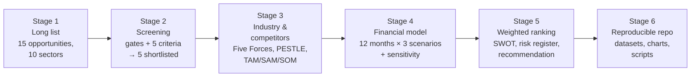
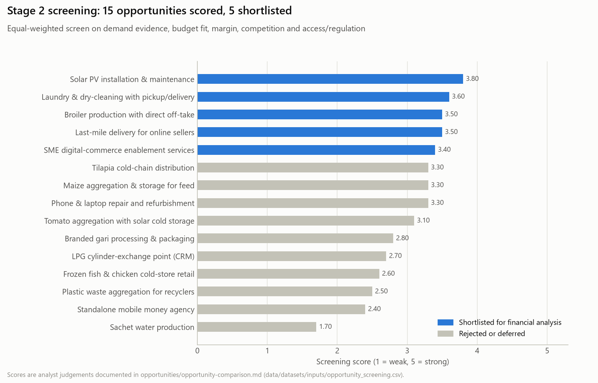
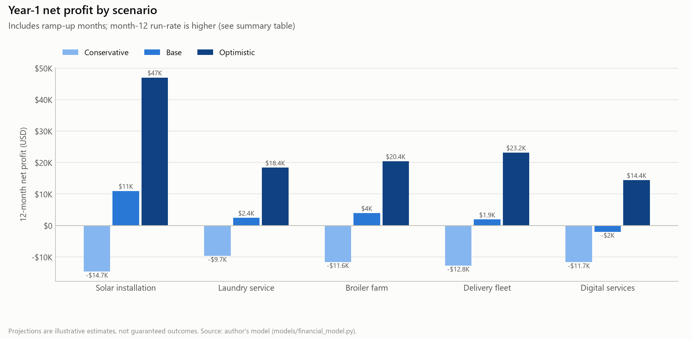
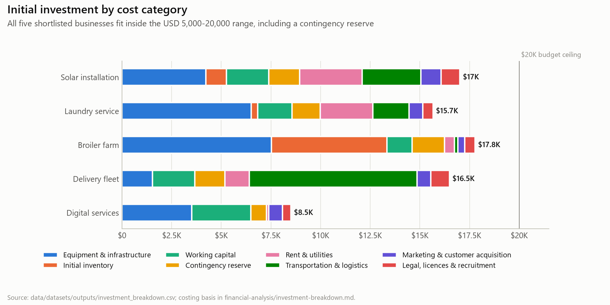
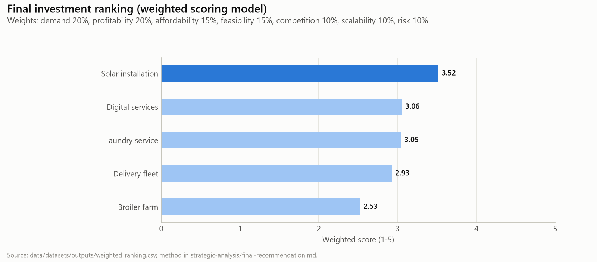
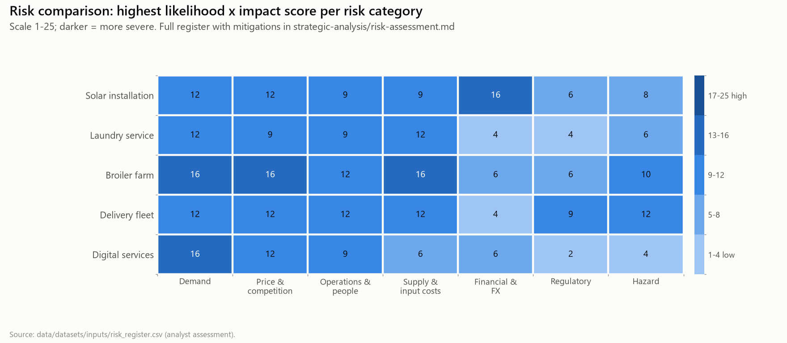

# Ghana Business Opportunity Analysis 2026

### Identifying profitable small-business opportunities in Ghana with an investment of US$5,000–20,000


An evidence-based **investment feasibility case study**, written as a consulting assignment for a prospective investor. It screens 15 business opportunities across 10 sectors, models five in detail with a reproducible financial model, and recommends one with explicit conditions, stage gates and risks.

> **Bottom line:** For a Ghanaian owner-operator, **a certified mid-market solar PV installation & maintenance business in Accra** offers the strongest combination of demand, profitability and controllable risk. The base case shows **~US$11.0k year-1 net profit on ~US$17.0k invested, with payback in about 12 months**. It should be launched behind a 6-week validation sprint, with USD-indexed quotes and a cash reserve. **Laundry** is the alternative for risk-averse and foreign investors. **Broiler grow-out is not recommended** at this budget.
>
> *All financial figures are conditional projections, not guaranteed returns.*

**Quick links:** [Executive summary](executive-summary/executive-summary.md) · [Final recommendation](strategic-analysis/final-recommendation.md) · [Financial model](models/financial_model.py) · [Sources](data/sources.md) · [Charts](visuals/investment-comparison.md)

---

## Contents

1. [Project overview](#project-overview)
2. [Research methodology](#research-methodology)
3. [Opportunities identified](#opportunities-identified)
4. [Top five: financial comparison](#top-five-financial-comparison)
5. [Final ranking](#final-ranking)
6. [Main findings](#main-findings)
7. [Key risks](#key-risks)
8. [Final recommendation](#final-recommendation)
9. [Repository navigation](#repository-navigation)
10. [Reproduce the analysis](#reproduce-the-analysis)
11. [Data sources](#data-sources)
12. [Disclaimer](#disclaimer)

## Project overview

| | |
|---|---|
| **Research question** | Which small business can an entrepreneur realistically establish in Ghana in 2027 with US$5,000–20,000, and which offers the best balance of demand, profitability, feasibility and risk? |
| **Investment range** | US$5,000–20,000, including working capital and a 10% contingency reserve |
| **Target market** | Ghana, with launch focus on Greater Accra (Ashanti/Kumasi as expansion market) |
| **Investor profiles** | Ghanaian owner-operators **and** foreign investors (the July 2026 investment law, Act 1173, is analysed in full) |
| **Currency and date** | USD at GHS 11.70 = US$1 (Bank of Ghana interbank rate, 13 Nov 2026); sources accessed November 2026 |

**Objectives:** (1) identify at least 10 evidence-backed opportunities; (2) validate demand and reject weak ideas on evidence; (3) analyse industries and competitors; (4) build transparent 12-month financial models with three scenarios; (5) rank the shortlist with a weighted scoring model; (6) make a practical, conditional recommendation.

## Research methodology



- **188 cited sources** in a source hierarchy: Ghanaian official bodies (Bank of Ghana, GSS, GIPC/GIPA, GRA, PURC, Energy Commission, MoFA), then multilaterals and research (World Bank, IMF, USDA, FAO, IGC), then credible media, then price listings.
- **Every number is labelled** as **[F]** verified fact, **[E]** estimate, **[A]** assumption or **[P]** projection.
- **No hand-typed financial tables.** All tables in the write-up are generated from the model and injected into the documents, so prose and model cannot drift apart.

Full method: [research-methodology.md](research/research-methodology.md)

## Opportunities identified

Fifteen opportunities were profiled and screened. Two more (event rental, car wash) were dropped at the evidence gate.



| Decision | Opportunities |
|---|---|
| ✅ **Shortlisted** | Solar PV installation · Laundry & dry-cleaning · Broiler production · Last-mile delivery for online sellers · SME digital-commerce services |
| 🔶 First reserve | Tilapia cold-chain distribution |
| ⏸ Deferred | Maize aggregation · Tomato solar cold storage · LPG cylinder exchange |
| ❌ Rejected on evidence | Sachet water (saturated, reserved for Ghanaians) · Plastic aggregation (2026 price collapse) · Mobile money agency (54% of agents inactive) · Frozen-food cold store · Branded gari · Phone repair |

Details: [opportunity-identification.md](opportunities/opportunity-identification.md) · [opportunity-comparison.md](opportunities/opportunity-comparison.md) · [shortlisted-businesses.md](opportunities/shortlisted-businesses.md)

## Top five: financial comparison

Base case, 12 months from launch. **[P] projections.**

<!-- BEGIN TABLE: financial_comparison_base -->
| Business | Initial investment | Year-1 revenue | Gross margin | Year-1 net profit | Year-1 ROI | Month-12 run-rate ROI | Operating break-even month | Payback (months) |
|---|---|---|---|---|---|---|---|---|
| Solar installation | $17,013 | $151,561 | 32% | $10,983 | 65% | 114% | 3 | 12.4 |
| Laundry service | $15,656 | $34,039 | 81% | $2,440 | 16% | 67% | 5 | 18.4 |
| Broiler farm | $17,777 | $82,479 | 25% | $3,955 | 22% | 37% | 3 | 28.9 |
| Delivery fleet | $16,485 | $35,073 | 73% | $1,899 | 12% | 48% | 4 | 20.5 |
| Digital services | $8,505 | $20,923 | 86% | -$2,012 | -24% | 71% | 7 | 26.4 |
<!-- END TABLE: financial_comparison_base -->

| Year-1 net profit by scenario | Initial investment by category |
|---|---|
|  |  |

<!-- BEGIN TABLE: scenario_net_profit -->
| Business | Conservative | Base | Optimistic | Spread (optimistic - conservative) |
|---|---|---|---|---|
| Solar installation | -$14,673 | $10,983 | $47,006 | $61,679 |
| Laundry service | -$9,674 | $2,440 | $18,382 | $28,057 |
| Broiler farm | -$11,602 | $3,955 | $20,422 | $32,024 |
| Delivery fleet | -$12,759 | $1,899 | $23,176 | $35,935 |
| Digital services | -$11,684 | -$2,012 | $14,422 | $26,105 |
<!-- END TABLE: scenario_net_profit -->

**Every business loses money in the conservative case.** That is why the recommendation includes stage gates and a cash reserve ([cash-flow-analysis.md](financial-analysis/cash-flow-analysis.md)).

## Final ranking

Weighted scoring model using the brief's weights: demand 20%, profitability 20%, affordability 15%, feasibility 15%, competition 10%, scalability 10%, risk 10%. Affordability, profitability and risk are **calculated by formula** from model outputs; the other four are analyst-scored with written rationale.



<!-- BEGIN TABLE: weighted_ranking -->
| Rank | Business | Market demand | Investment affordability | Profitability potential | Competitive intensity | Operational feasibility | Scalability | Risk level | Weighted score |
|---|---|---|---|---|---|---|---|---|---|
| 1 | Solar installation | 5.00 | 1.80 | 4.05 | 3.00 | 3.00 | 4.00 | 2.90 | **3.52** |
| 2 | Digital services | 2.00 | 4.07 | 2.88 | 2.00 | 4.00 | 3.00 | 3.71 | **3.06** |
| 3 | Laundry service | 3.00 | 2.16 | 2.78 | 3.00 | 4.00 | 3.00 | 3.67 | **3.05** |
| 4 | Delivery fleet | 4.00 | 1.94 | 2.27 | 2.50 | 3.00 | 4.00 | 2.86 | **2.93** |
| 5 | Broiler farm | 4.00 | 1.59 | 1.98 | 2.00 | 3.00 | 2.00 | 2.43 | **2.53** |
<!-- END TABLE: weighted_ranking -->

The order is unchanged under equal and risk-averse weights, but solar's lead narrows from 0.46 to 0.08 points when risk is weighted at 25% ([robustness test](strategic-analysis/final-recommendation.md#robustness-does-the-ranking-depend-on-the-weights)).

## Main findings

1. **The macro window is favourable.** GDP growth ~6%, inflation 5.5%, lending rates down from 24% to 16% in a year, IMF programme completed, rating upgrades in 2026 ([economic-analysis.md](research/economic-analysis.md)).
2. **Foreign-investor rules changed in July 2026.** Act 1173 removed minimum capital for non-trading foreign businesses, but trading needs US$500k cash equity and six activities remain reserved for Ghanaians. GIPA fees of US$3,500–5,250 are material at this budget ([country-overview.md](research/country-overview.md#4-rules-for-foreign-investors)).
3. **Services wrapped around infrastructure gaps beat manufacturing at this budget.** Power, logistics and laundry gaps can be served with US$5–20k; import-substitution manufacturing cannot.
4. **Strong demand is not the same as good economics.** Chicken is ~82% imported, but local birds cost ~GHS 49/kg against ~GHS 33–40/kg imported, and 2026 brought a glut. The broiler farm ranks last.
5. **Solar has the best evidence and economics, and one big risk.** A 20% cedi depreciation without re-pricing would cut year-1 profit by ~US$16k. That risk is controllable with deposits and USD-indexed quotes.
6. **The lowest-capital option has the weakest evidence.** Digital services needs only ~US$8.5k but has no proof that micro-firms will pay monthly fees.

## Key risks



| Risk | Most exposed | Mitigation |
|---|---|---|
| Cedi depreciation | Solar | USD-indexed quotes, 7-day validity, buy after deposit |
| Price competition / import price ceiling | Broiler, solar | Compete on service and freshness; pre-sell |
| Slow customer build-up | Digital, laundry | Validation sprint; subscriptions; stage gates |
| Utility outages and tariff rises | Laundry, broiler | Generator and water storage; night-time loads |
| Regulatory change (okada rules, Act 1173 regulations) | Delivery, foreign investors | Early registration; legal opinion |

Full register: [risk-assessment.md](strategic-analysis/risk-assessment.md) · Sensitivity: [break-even-analysis.md](financial-analysis/break-even-analysis.md)

## Final recommendation

| Investor profile | Recommendation |
|---|---|
| **Ghanaian owner-operator with a certified electrician** | **Solar PV installation & maintenance**, launched in stages: ≥ 3 paid deposits by week 6 before the main investment; reserve ~US$5,800 |
| Risk-averse, no technical partner | **Laundry service**: no FX exposure, smallest conservative-case funding gap |
| Foreign investor | **Laundry as a joint venture** (~US$19.2k incl. GIPA fee) or **digital services** (~US$13.8k even wholly foreign). Get a legal opinion before solar ("trading" risk) |
| Interested in agriculture | Avoid broiler grow-out without contracted off-take; study the first reserve, **tilapia cold-chain distribution** |

Full reasoning, Business Model Canvas, roadmap and stop-loss rules: [final-recommendation.md](strategic-analysis/final-recommendation.md)

## Repository navigation

```
ghana-business-opportunity-analysis/
├── README.md                          ← you are here
├── executive-summary/
│   └── executive-summary.md           two-page investor brief
├── research/
│   ├── research-methodology.md        method, evidence labels, limitations
│   ├── country-overview.md            business environment, registration, Act 1173, taxes
│   ├── economic-analysis.md           macro dashboard and implications
│   ├── industry-analysis.md           Porter's Five Forces and value chains
│   └── market-demand.md               demand validation, TAM/SAM/SOM, segmentation
├── opportunities/
│   ├── opportunity-identification.md  15-opportunity long list
│   ├── opportunity-comparison.md      screening, robustness, rejections
│   └── shortlisted-businesses.md      business model of each finalist
├── financial-analysis/
│   ├── investment-breakdown.md        startup budgets, item by item
│   ├── financial-assumptions.md       every model input with basis and source
│   ├── revenue-projections.md         12-month P&L, three scenarios
│   ├── cash-flow-analysis.md          cash adequacy and funding gaps
│   └── break-even-analysis.md         break-even, payback, sensitivity
├── strategic-analysis/
│   ├── competitor-analysis.md         named competitors and public prices
│   ├── swot-analysis.md               SWOT ×5 + TOWS for the winner
│   ├── pestle-analysis.md             PESTLE with impact scoring
│   ├── risk-assessment.md             35-risk register and early warnings
│   └── final-recommendation.md        scoring model, ranking, BMC, roadmap
├── models/                            reproducible Python pipeline
│   ├── financial_model.py             driver-based 12-month model
│   ├── scoring_model.py               screening robustness + weighted ranking
│   ├── make_charts.py                 all charts
│   ├── report_tables.py               generates and injects every table
│   └── run_all.py                     one command to rebuild everything
├── data/
│   ├── README.md                      data dictionary
│   ├── sources.md                     188 sources with dates and URLs
│   └── datasets/
│       ├── inputs/                    assumptions (CSV)
│       └── outputs/                   model results (CSV + tables)
├── visuals/
│   ├── investment-comparison.md       chart gallery
│   └── financial-charts/              9 PNG charts
├── docs/
│   └── publishing-guide.md
├── requirements.txt
└── LICENSE
```

## Reproduce the analysis

Requires Python 3.10+.

```bash
pip install -r requirements.txt
python models/run_all.py
```

This rebuilds all model outputs, the ranking, the nine charts and **every table in the documents**. To test your own assumptions, edit the CSVs in [`data/datasets/inputs/`](data/datasets/inputs/) (for example the exchange rate in `global_assumptions.csv`) and run the command again. The pipeline validates budgets, weights and table references as it runs ([data dictionary](data/README.md)).

## Data sources

Primary and authoritative sources include the **Bank of Ghana** (MPC releases, Annual Report 2025, Summary of Economic and Financial Data), **Ghana Statistical Service**, **GIPC/GIPA** (Act 1173, fee schedule), **Ghana Revenue Authority**, **Office of the Registrar of Companies**, **PURC**, **Energy Commission**, **Ministry of Food and Agriculture**, **Ministry of Finance**, **SSNIT**, **IMF**, **World Bank (B-READY)**, **USDA FAS**, **FAO GLOBEFISH**, **International Growth Centre** and **DataReportal**, complemented by Ghanaian media and company price lists.

Every statistic carries a source ID that resolves to publisher, publication date, URL and verification status in **[data/sources.md](data/sources.md)**.

## Disclaimer

This is an independent research case study prepared for **portfolio and educational purposes**. It is **not financial, investment, legal or tax advice**. The analysis relies on secondary sources available in November 2026, some of which are media reports, marketplace listings or search-level evidence (all labelled). Financial figures are **projections based on stated assumptions and are not guarantees** of future results; actual outcomes may differ materially. Laws, tax rules, prices and exchange rates change. Anyone considering an investment should conduct primary research and obtain professional legal, tax and financial advice in Ghana. Company names are mentioned only to describe the competitive landscape using publicly available information; no endorsement or affiliation is implied.

---

<sub>Prepared by [@seamuddin](https://github.com/seamuddin) · Code: MIT · Content: CC BY 4.0 — see [LICENSE](LICENSE)</sub>
