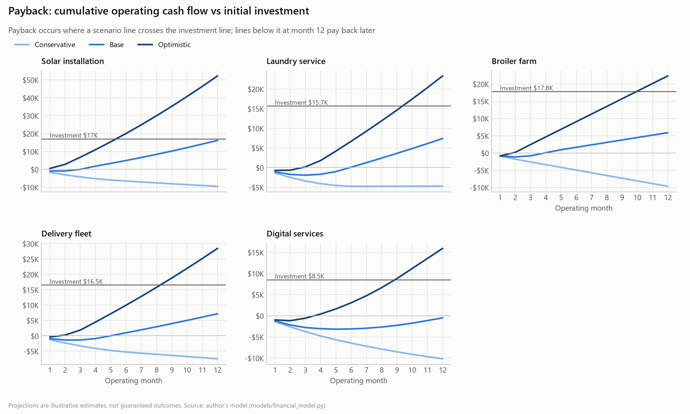
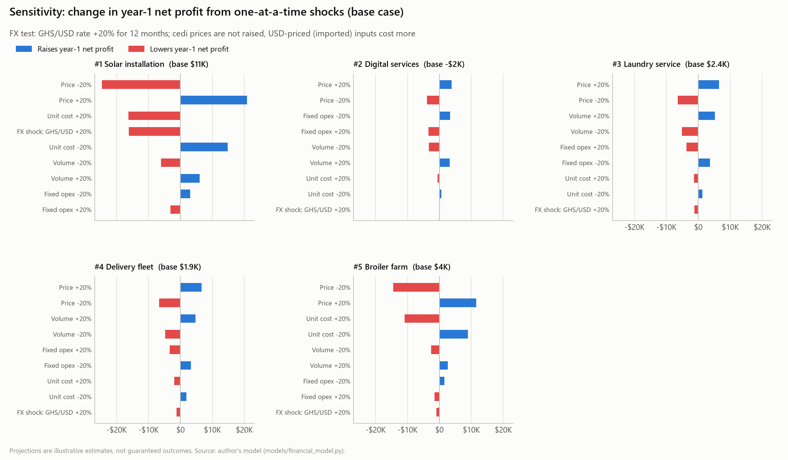

# Break-Even, Payback and Sensitivity Analysis

[← Back to README](../README.md) · Related: [revenue-projections.md](revenue-projections.md) · [cash-flow-analysis.md](cash-flow-analysis.md)

> **[P] Projections.** Break-even revenue = (fixed operating costs + depreciation & amortisation) ÷ contribution margin, using the month-12 cost structure. The contribution margin is after COGS, variable operating costs and any turnover tax. The margin of safety is how far month-12 revenue could fall before the business stops covering its costs.

## 1. Break-even and payback

<!-- BEGIN TABLE: breakeven -->
| Business | Contribution margin | Break-even revenue / month | Month-12 revenue | Margin of safety | Break-even month (cons / base / opt) | Payback months (cons / base / opt) |
|---|---|---|---|---|---|---|
| Solar installation | 28% | $7,918 | $15,932 | 50% | not reached / 3 / 1 | not reached / 12.4 / 6 |
| Laundry service | 76% | $2,568 | $3,720 | 31% | not reached / 5 / 3 | > 60 / 18.4 / 10 |
| Broiler farm | 22% | $4,777 | $8,248 | 42% | not reached / 3 / 2 | not reached / 28.9 / 10 |
| Delivery fleet | 68% | $2,689 | $3,656 | 26% | not reached / 4 / 2 | not reached / 20.5 / 9 |
| Digital services | 78% | $1,957 | $2,598 | 25% | not reached / 7 / 3 | not reached / 26.4 / 9 |
<!-- END TABLE: breakeven -->

**Interpretation**

- **Low contribution margins (solar ≈ 28%, broilers ≈ 22%) mean volume and price discipline matter enormously.** Every lost sale costs most of the fixed-cost cover. High-margin service businesses (laundry, delivery, digital) are more forgiving per unit, but their fixed costs are large relative to their small revenues.
- **Margin of safety is thinnest for digital services and delivery (≈ 25%).** A one-quarter shortfall in revenue erases their month-12 profit.
- **No business breaks even in the conservative case within 12 months.** This is consistent with the cash-adequacy finding in [cash-flow-analysis.md](cash-flow-analysis.md).

## 2. Sensitivity analysis

Each driver is shocked by ±20% on its own, holding everything else at the base case. The FX test raises the GHS/USD rate by 20% for the whole year **without** any price increase in cedis. GHS-priced items fall in USD terms; USD-priced inputs (imported solar equipment) do not.

<!-- BEGIN TABLE: sensitivity -->
| Shock (one at a time, base case) | Solar installation | Laundry service | Broiler farm | Delivery fleet | Digital services |
|---|---|---|---|---|---|
| *Base-case year-1 net profit* | *$10,983* | *$2,440* | *$3,955* | *$1,899* | *-$2,012* |
| Price -20% | -$24,631 | -$6,467 | -$14,418 | -$6,629 | -$3,852 |
| Price +20% | $20,878 | $6,467 | $11,541 | $6,629 | $3,852 |
| Volume -20% | -$6,039 | -$5,144 | -$2,593 | -$4,745 | -$3,264 |
| Volume +20% | $6,039 | $5,144 | $2,593 | $4,745 | $3,264 |
| Unit cost +20% | -$16,301 | -$1,323 | -$10,842 | -$1,884 | -$588 |
| Unit cost -20% | $14,839 | $1,323 | $8,948 | $1,884 | $588 |
| Fixed opex +20% | -$3,086 | -$3,665 | -$1,524 | -$3,310 | -$3,364 |
| Fixed opex -20% | $3,086 | $3,665 | $1,524 | $3,310 | $3,364 |
| FX shock: GHS/USD +20% | -$16,182 | -$1,232 | -$891 | -$1,196 | $84 |
<!-- END TABLE: sensitivity -->

### Findings

1. **Price is the most powerful lever for every business,** but its scale differs hugely. For solar, a 20% price cut erases more than twice the base-case profit. For broilers it erases more than three times the base-case profit. Both are commodity-like, low-margin businesses where price realisation decides viability. The evidence agrees: the 2026 broiler glut (AGR-06, AGR-36) and informal solar kits at GHS 25–37k (ENE-18).
2. **Unit cost is almost as important for solar and broilers.** Equipment and feed costs are two-thirds to three-quarters of their revenue. A 20% rise in equipment or feed prices would wipe out the entire base-case profit of both businesses.
3. **FX is solar's single largest external risk.** A 20% weaker cedi with no re-pricing turns solar's base-case profit into a loss of roughly US$5,000. Laundry, delivery and broilers are largely naturally hedged: local costs and local revenues. **Mitigation is operational, not financial:** quote in cedis but index to USD, keep quote validity at 7 days, and buy equipment only after a customer deposit. Under that policy, FX risk is mostly passed to the customer.
4. **Fixed costs matter most for the service businesses** (laundry, delivery, digital). For them a 20% fixed-cost overrun is as damaging as a 20% volume shortfall. Lean staffing at launch is the key control.
5. **Volume matters least for solar and broilers** relative to price and cost. For them, *margin per unit* is the binding constraint, not the number of units.

## 3. What would have to be true for each business to break even in year 1?

Derived from the break-even table above and the base-case assumptions:

| Business | Approximate requirement at month-12 cost structure |
|---|---|
| Solar installation | ~US$7,900 revenue per month ≈ 2.4 systems per month at the base-case mix of 5 kVA and 3 kVA systems |
| Laundry service | ~US$2,600 revenue per month ≈ 1,030 kg + 810 pressed items + 90 special items |
| Broiler farm | ~US$4,800 revenue per month ≈ 520 birds at GHS 105, **provided the price holds** |
| Delivery fleet | ~US$2,700 revenue per month ≈ 11 drops per bike per day at GHS 25 |
| Digital services | ~US$2,000 revenue per month ≈ 10–11 retainer clients plus 3 set-ups and 9 workshop attendees a month |

These are the KPIs to test in the validation sprint recommended in [final-recommendation.md](../strategic-analysis/final-recommendation.md).
