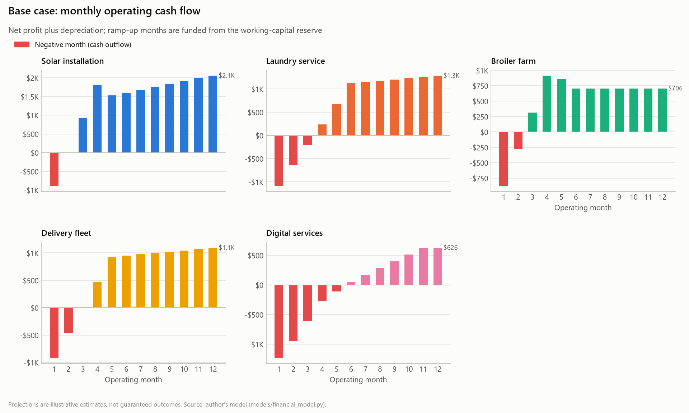
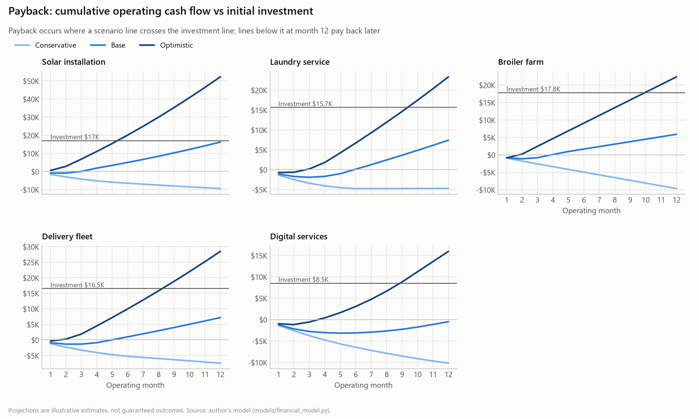

# Cash Flow Analysis

[← Back to README](../README.md) · Related: [revenue-projections.md](revenue-projections.md) · [break-even-analysis.md](break-even-analysis.md) · [investment-breakdown.md](investment-breakdown.md)

> **[P] Projections.** Operating cash flow = net profit + depreciation & amortisation. Opening cash = the working-capital and contingency lines of the startup budget; everything else is spent on assets, stock, deposits and pre-opening costs before month 1.

## 1. Monthly operating cash flow (base case)

- **Solar** is cash-positive from month 3 and generates the most cash per month.
- **Laundry, delivery and broilers** burn cash for 2–3 months, then settle at roughly US$700–1,300 per month by month 12.
- **Digital services** burns cash for five months. It is the only business whose base-case reserve needed to be increased (see section 3).

## 2. Cumulative cash flow and payback

Payback is measured against the **entire** initial investment, including working capital and contingency that would remain in the business as cash. This is deliberately conservative. Payback periods are in [break-even-analysis.md](break-even-analysis.md).

## 3. Is the cash reserve big enough?

This is the most decision-relevant table in the financial analysis. It shows the lowest cash balance each business reaches, and how much **additional** money would be needed to avoid running out of cash within 12 months.

<!-- BEGIN TABLE: cash_adequacy -->
| Business | Scenario | Cash reserve at launch | Lowest cash balance | Month of lowest balance | Month-12 cash balance | Extra funding needed |
|---|---|---|---|---|---|---|
| Solar installation | Conservative | $3,683 | -$5,773 | 12 | -$5,773 | **$5,773** |
|  | Base | $3,683 | $2,797 | 1 | $19,883 | none |
|  | Optimistic | $3,683 | $4,211 | 1 | $55,906 | none |
| Laundry service | Conservative | $3,133 | -$1,631 | 6 | -$1,586 | **$1,631** |
|  | Base | $3,133 | $1,199 | 3 | $10,528 | none |
|  | Optimistic | $3,133 | $2,413 | 1 | $26,470 | none |
| Broiler farm | Conservative | $2,898 | -$6,784 | 12 | -$6,784 | **$6,784** |
|  | Base | $2,898 | $1,743 | 2 | $8,773 | none |
|  | Optimistic | $2,898 | $2,023 | 1 | $25,240 | none |
| Delivery fleet | Conservative | $3,635 | -$3,848 | 12 | -$3,848 | **$3,848** |
|  | Base | $3,635 | $2,261 | 2 | $10,811 | none |
|  | Optimistic | $3,635 | $3,256 | 1 | $32,087 | none |
| Digital services | Conservative | $3,765 | -$6,409 | 12 | -$6,409 | **$6,409** |
|  | Base | $3,765 | $595 | 5 | $3,263 | none |
|  | Optimistic | $3,765 | $2,595 | 2 | $19,696 | none |
<!-- END TABLE: cash_adequacy -->

### What this means for an investor

1. **The base case is fully funded for every business.** The startup budgets include enough working capital to carry each business through its ramp-up.
2. **In the conservative case, every business runs out of cash within 12 months** and would need roughly US$1,600–6,800 more. An investor should either:
   - hold back a **reserve equal to the conservative-case gap** outside the business. That is about 10% of the initial investment for laundry, 23% for delivery, 34% for solar, 38% for broilers and 75% for digital services, or
   - commit in advance to **stop-loss triggers** that end or pivot the business before the reserve is exhausted. Recommended triggers are in [final-recommendation.md](../strategic-analysis/final-recommendation.md#6-stage-gates-and-stop-loss-rules).
3. **The model caught a real funding gap.** In the first run, digital services' base-case cash balance went negative in month 5. Its working-capital reserve was raised from GHS 25,000 to GHS 35,000 so that the base case is genuinely funded. This change is recorded in [startup_costs.csv](../data/datasets/inputs/startup_costs.csv).

## 4. Cash-flow risks the model does not capture

| Risk | Business most exposed | Mitigation |
|---|---|---|
| Customer payment delays (credit sales to SMEs, hotels, schools) | Solar, laundry B2B, broilers | Deposits before procurement; MoMo prepayment; short credit terms for B2B only |
| Lumpy sales (one large solar job, one batch of birds) | Solar, broilers | Keep at least two months of fixed costs in cash at all times |
| Supplier prepayment in USD while customers pay in cedis | Solar | Buy only after customer deposit; quote with 7-day validity |
| Cash-on-delivery float tied up with riders | Delivery | Daily MoMo settlement; rider deposits |
| Festive stock build-up (Christmas birds) | Broilers | Pre-sell festive batches with deposits |
