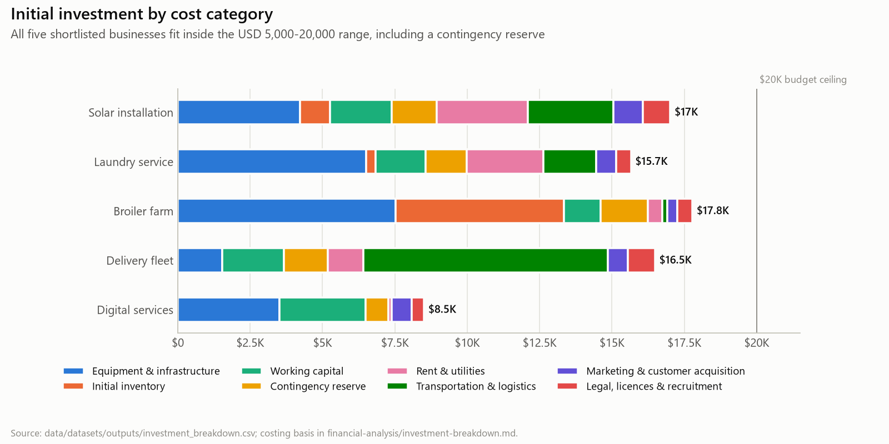

# Investment Breakdown

[← Back to README](../README.md) · Related: [financial-assumptions.md](financial-assumptions.md) · [cash-flow-analysis.md](cash-flow-analysis.md)

> **All five shortlisted businesses can be launched within US$5,000–20,000, including a 10% contingency reserve.** Four of them need US$15,000–18,000. The capital-light digital-services business needs about US$8,500. The model checks this constraint automatically and stops if any budget leaves the range.

## 1. Investment by category (USD)

<!-- BEGIN TABLE: investment_by_category -->
| Category | Solar installation | Laundry service | Broiler farm | Delivery fleet | Digital services |
|---|---|---|---|---|---|
| Registration & legal | $509 | $253 | $306 | $593 | $168 |
| Equipment & infrastructure | $4,231 | $6,501 | $7,521 | $1,538 | $3,504 |
| Initial inventory | $1,026 | $342 | $5,812 | $0 | $0 |
| Rent & utilities | $3,162 | $2,650 | $513 | $1,231 | $128 |
| Transportation & logistics | $2,949 | $1,838 | $171 | $8,462 | $0 |
| Marketing & customer acquisition | $1,026 | $684 | $342 | $684 | $684 |
| Staffing (pre-opening) | $427 | $256 | $214 | $342 | $256 |
| Working capital | $2,137 | $1,709 | $1,282 | $2,137 | $2,991 |
| Contingency reserve | $1,547 | $1,423 | $1,616 | $1,499 | $773 |
| **Total initial investment** | **$17,013** | **$15,656** | **$17,777** | **$16,485** | **$8,505** |
<!-- END TABLE: investment_by_category -->

*Amounts are converted from cedis at GHS 11.70/USD. "Working capital" and "Contingency reserve" remain as cash at launch and fund ramp-up losses (see [cash-flow-analysis.md](cash-flow-analysis.md)).*

## 2. What drives each budget

| Business | Largest cost blocks | Insight |
|---|---|---|
| **Solar installation** | Showroom rent advance, tools and demonstration system, delivery tricycle | Equipment for customers is **not** in the budget, because it is bought only after a customer deposit. The investment is in capability (licensing, tools, credibility), not inventory. |
| **Laundry service** | Washers, washer-dryer, industrial iron, backup generator, shop rent advance | About 40% of the budget is equipment. Backup power and water storage are non-negotiable given 2024–2026 outages (ENE-03–06). |
| **Broiler farm** | Poultry housing and the **first batch of birds in progress** (~US$5,800) | Broilers are the most working-capital-intensive option: each 1,000-bird batch ties up GHS 66–71k until sale (AGR-33 cost build-up). |
| **Delivery fleet** | Four motorbikes (~US$7,500) | Over half the budget sits in vehicles, which depreciate quickly (36 months) and carry theft and accident risk. |
| **Digital services** | Laptops, content equipment, and a large cash reserve | Low fixed assets; most of the money funds the client-acquisition period. |

### Cross-cutting findings

1. **Rent advances are a hidden capital requirement.** Twelve months' prepaid rent or land lease costs US$500–3,100 per business. The Rent Act caps advances at six months (SVC-07). Negotiating to the legal limit would free up to US$1,500 of cash for the solar and laundry businesses.
2. **Regulatory set-up costs are small in money but large in time.** Registration, permits and licences cost under US$700 for every business, but EPA and assembly permits can take weeks (REG-25, REG-26).
3. **For a foreign investor, add the GIPA registration fee:** US$3,500 for a joint venture or US$5,250 for a wholly foreign company (REG-08). That pushes the four larger budgets to US$19,200–23,000. **Only laundry (US$19,156) and delivery (US$19,985) stay within US$20,000, and only as joint ventures**; digital services fits under either structure.

## 3. Item-level startup budgets

Each line shows its evidence basis and source ID ([data/sources.md](../data/sources.md)). "Life" is the depreciation or amortisation period used in the model.

<b>Solar installation</b>

<!-- BEGIN TABLE: investment_items_SOL -->
| Category | Item | Amount (local) | USD | Life (months) | Basis | Source |
|---|---|---|---|---|---|---|
| Registration & legal | Company registration (private company limited by shares) | GHS 585 | $50 |  | Verified fact | REG-09 |
| Registration & legal | Stated-capital duty (1% of GHS 50000 stated capital) | GHS 500 | $43 |  | Verified fact | REG-09 |
| Registration & legal | Energy Commission electrical wiring certification (commercial) | GHS 870 | $74 |  | Verified fact | REG-23 |
| Registration & legal | Assembly business operating permit | GHS 1,000 | $85 |  | Assumption | REG-26 |
| Registration & legal | Legal and accounting set-up (VAT and SSNIT registration, contracts) | GHS 3,000 | $256 |  | Assumption |  |
| Equipment & infrastructure | Installation tools and test instruments | GHS 15,000 | $1,282 | 36 | Estimate |  |
| Equipment & infrastructure | PPE and fall-protection kit | GHS 3,000 | $256 | 24 | Estimate |  |
| Equipment & infrastructure | 3 kVA demonstration system installed at the showroom (at cost) | GHS 18,500 | $1,581 | 60 | Estimate | ENE-17, ENE-18 |
| Equipment & infrastructure | Office furniture, laptop, PV design software | GHS 9,000 | $769 | 36 | Estimate |  |
| Equipment & infrastructure | Showroom fit-out and signage | GHS 4,000 | $342 | 36 | Assumption |  |
| Initial inventory | Balance-of-system stock (cables, breakers, rails, connectors) | GHS 12,000 | $1,026 |  | Estimate |  |
| Rent & utilities | Showroom/office rent: 12 months prepaid at GHS 3000 | GHS 36,000 | $3,077 | 12 | Estimate | SVC-02, SVC-03, SVC-07 |
| Rent & utilities | Utility connection deposits | GHS 1,000 | $85 |  | Assumption |  |
| Transportation & logistics | Motor tricycle (aboboyaa) for equipment delivery | GHS 32,000 | $2,735 | 48 | Verified fact | ENE-36 |
| Transportation & logistics | Tricycle registration and first-year insurance | GHS 2,500 | $214 | 12 | Assumption |  |
| Marketing & customer acquisition | Brand identity, website, launch campaign, brochures | GHS 12,000 | $1,026 |  | Assumption |  |
| Staffing (pre-opening) | Recruitment and manufacturer product training | GHS 5,000 | $427 |  | Assumption |  |
| Working capital | Operating cash reserve for ramp-up months | GHS 25,000 | $2,137 |  | Assumption |  |
| Contingency reserve | 10% of the items above (calculated) |  | $1,547 |  | Assumption |  |
| **Total** |  |  | **$17,013** |  |  |  |
<!-- END TABLE: investment_items_SOL -->

<b>Laundry service</b>

<!-- BEGIN TABLE: investment_items_LAU -->
| Category | Item | Amount (local) | USD | Life (months) | Basis | Source |
|---|---|---|---|---|---|---|
| Registration & legal | Business name registration and name search | GHS 160 | $14 |  | Verified fact | REG-09 |
| Registration & legal | Assembly business operating permit | GHS 800 | $68 |  | Assumption | REG-26 |
| Registration & legal | EPA environmental registration (wastewater) | GHS 1,000 | $85 |  | Assumption | REG-25 |
| Registration & legal | Set-up advisory (bookkeeping, SSNIT registration) | GHS 1,000 | $85 |  | Assumption |  |
| Equipment & infrastructure | 2 x 20 kg front-load washers (GHS 5999 each) | GHS 12,000 | $1,026 | 48 | Listing | SVC-36 |
| Equipment & infrastructure | 1 x 20 kg / 12 kg washer-dryer | GHS 20,000 | $1,709 | 48 | Listing | SVC-16 |
| Equipment & infrastructure | Industrial steam iron with boiler | GHS 8,000 | $684 | 48 | Listing | SVC-36 |
| Equipment & infrastructure | Pressing tables and domestic irons | GHS 2,500 | $214 | 36 | Estimate |  |
| Equipment & infrastructure | 5.5 kVA backup generator | GHS 11,560 | $988 | 60 | Listing | SVC-27 |
| Equipment & infrastructure | Water storage (2000 L tank) and pump | GHS 5,000 | $427 | 60 | Assumption |  |
| Equipment & infrastructure | Racks, hangers, scale, garment tagging system | GHS 4,000 | $342 | 36 | Assumption |  |
| Equipment & infrastructure | POS phone, laptop, booking software set-up | GHS 3,000 | $256 | 36 | Assumption |  |
| Equipment & infrastructure | Shop fit-out (plumbing, electrical, counter) | GHS 10,000 | $855 | 36 | Assumption |  |
| Initial inventory | Detergents, softeners, garment bags, hangers (about 2 months) | GHS 4,000 | $342 |  | Assumption |  |
| Rent & utilities | Shop rent: 12 months prepaid at GHS 2500 | GHS 30,000 | $2,564 | 12 | Estimate | SVC-02, SVC-06, SVC-07 |
| Rent & utilities | Utility connection deposits | GHS 1,000 | $85 |  | Assumption |  |
| Transportation & logistics | Pickup and delivery motorbike (125-150 cc) | GHS 20,000 | $1,709 | 36 | Verified fact | ENE-35 |
| Transportation & logistics | Motorbike registration and first-year insurance | GHS 1,500 | $128 | 12 | Assumption |  |
| Marketing & customer acquisition | Signage, flyers, launch promotions, social media ads | GHS 8,000 | $684 |  | Assumption |  |
| Staffing (pre-opening) | Recruitment and garment-care training | GHS 3,000 | $256 |  | Assumption |  |
| Working capital | Operating cash reserve for ramp-up months | GHS 20,000 | $1,709 |  | Assumption |  |
| Contingency reserve | 10% of the items above (calculated) |  | $1,423 |  | Assumption |  |
| **Total** |  |  | **$15,656** |  |  |  |
<!-- END TABLE: investment_items_LAU -->

<b>Broiler farm</b>

<!-- BEGIN TABLE: investment_items_BRO -->
| Category | Item | Amount (local) | USD | Life (months) | Basis | Source |
|---|---|---|---|---|---|---|
| Registration & legal | Company registration (private company limited by shares) | GHS 585 | $50 |  | Verified fact | REG-09 |
| Registration & legal | Stated-capital duty (1% of GHS 50000 stated capital) | GHS 500 | $43 |  | Verified fact | REG-09 |
| Registration & legal | District assembly permit and veterinary registration | GHS 1,500 | $128 |  | Assumption |  |
| Registration & legal | EPA screening/registration for a poultry farm | GHS 1,000 | $85 |  | Assumption | REG-25 |
| Equipment & infrastructure | Two open-sided broiler houses (about 220 m2, block, timber, mesh, roofing) | GHS 40,000 | $3,419 | 120 | Assumption |  |
| Equipment & infrastructure | Feeders, drinkers, chick trays for 2200 birds | GHS 9,000 | $769 | 48 | Estimate | AGR-32, AGR-39 |
| Equipment & infrastructure | 4 gas brooders and brooder guards | GHS 7,000 | $598 | 48 | Listing | AGR-39 |
| Equipment & infrastructure | Water tank, pump, connection | GHS 8,000 | $684 | 60 | Assumption |  |
| Equipment & infrastructure | Small generator / solar lighting | GHS 6,000 | $513 | 60 | Assumption |  |
| Equipment & infrastructure | Dressing kit (scalder, plucker, knives) and 2 chest freezers | GHS 16,000 | $1,368 | 48 | Listing | SVC-26 |
| Equipment & infrastructure | Biosecurity kit (foot dips, sprayers, PPE) | GHS 2,000 | $171 | 24 | Estimate |  |
| Initial inventory | First batch in progress: 1100 chicks + feed + vaccines | GHS 68,000 | $5,812 |  | Estimate | AGR-09, AGR-10, AGR-11, AGR-33 |
| Rent & utilities | Land lease (about 1 acre, peri-urban): 12 months prepaid | GHS 6,000 | $513 | 12 | Assumption |  |
| Transportation & logistics | Crates and cool boxes for deliveries | GHS 2,000 | $171 | 36 | Assumption |  |
| Marketing & customer acquisition | Off-take development (sampling, buyer visits, labels) | GHS 4,000 | $342 |  | Assumption |  |
| Staffing (pre-opening) | Farm-hand recruitment and husbandry training | GHS 2,500 | $214 |  | Assumption |  |
| Working capital | Operating cash reserve (feed price spikes, batch overlap) | GHS 15,000 | $1,282 |  | Assumption |  |
| Contingency reserve | 10% of the items above (calculated) |  | $1,616 |  | Assumption |  |
| **Total** |  |  | **$17,777** |  |  |  |
<!-- END TABLE: investment_items_BRO -->

<b>Delivery fleet</b>

<!-- BEGIN TABLE: investment_items_DEL -->
| Category | Item | Amount (local) | USD | Life (months) | Basis | Source |
|---|---|---|---|---|---|---|
| Registration & legal | Business name registration and name search | GHS 160 | $14 |  | Verified fact | REG-09 |
| Registration & legal | Courier rider registration (4 riders x GHS 570) | GHS 2,280 | $195 |  | Verified fact | ENE-34 |
| Registration & legal | DVLA commercial registration and rider licence tests (4 bikes) | GHS 3,200 | $274 |  | Assumption | ENE-32 |
| Registration & legal | Assembly business operating permit and union/company membership | GHS 1,300 | $111 |  | Assumption | REG-26, ENE-33 |
| Equipment & infrastructure | Delivery boxes (4) | GHS 4,000 | $342 | 24 | Assumption |  |
| Equipment & infrastructure | Helmets, reflective gear, rain kits (4 riders) | GHS 4,000 | $342 | 24 | Assumption |  |
| Equipment & infrastructure | Rider smartphones (4) and dispatcher phone/laptop | GHS 10,000 | $855 | 24 | Assumption |  |
| Rent & utilities | Dispatch base / parking: 12 months prepaid at GHS 1200 | GHS 14,400 | $1,231 | 12 | Assumption | SVC-07 |
| Transportation & logistics | 4 delivery motorbikes (150 cc) at GHS 22000 | GHS 88,000 | $7,521 | 36 | Verified fact | ENE-35 |
| Transportation & logistics | Motorbike insurance (first year, 4 bikes) | GHS 8,000 | $684 | 12 | Assumption |  |
| Transportation & logistics | GPS trackers (4) | GHS 3,000 | $256 | 36 | Assumption |  |
| Marketing & customer acquisition | Seller acquisition campaign, bike branding, launch discounts | GHS 8,000 | $684 |  | Assumption |  |
| Staffing (pre-opening) | Rider recruitment and defensive-riding training | GHS 4,000 | $342 |  | Assumption |  |
| Working capital | Operating cash reserve including same-day COD settlement float | GHS 25,000 | $2,137 |  | Assumption | ENE-53 |
| Contingency reserve | 10% of the items above (calculated) |  | $1,499 |  | Assumption |  |
| **Total** |  |  | **$16,485** |  |  |  |
<!-- END TABLE: investment_items_DEL -->

<b>Digital services</b>

<!-- BEGIN TABLE: investment_items_DIG -->
| Category | Item | Amount (local) | USD | Life (months) | Basis | Source |
|---|---|---|---|---|---|---|
| Registration & legal | Business name registration and name search | GHS 160 | $14 |  | Verified fact | REG-09 |
| Registration & legal | Assembly business operating permit | GHS 800 | $68 |  | Assumption | REG-26 |
| Registration & legal | Set-up advisory (contracts, data-protection registration) | GHS 1,000 | $85 |  | Assumption |  |
| Equipment & infrastructure | 3 laptops (design-capable) | GHS 24,000 | $2,051 | 36 | Estimate |  |
| Equipment & infrastructure | Camera, lighting kit, smartphone for content | GHS 9,000 | $769 | 36 | Estimate |  |
| Equipment & infrastructure | Software licences (design, scheduling, hosting) - 12 months prepaid | GHS 6,000 | $513 | 12 | Estimate |  |
| Equipment & infrastructure | Furniture | GHS 2,000 | $171 | 36 | Assumption |  |
| Rent & utilities | Co-working desk deposit | GHS 1,500 | $128 |  | Assumption |  |
| Marketing & customer acquisition | Portfolio building, subsidised pilot clients, launch campaign | GHS 8,000 | $684 |  | Assumption |  |
| Staffing (pre-opening) | Recruitment and platform certification training | GHS 3,000 | $256 |  | Assumption |  |
| Working capital | Operating cash reserve for client-acquisition ramp | GHS 35,000 | $2,991 |  | Assumption |  |
| Contingency reserve | 10% of the items above (calculated) |  | $773 |  | Assumption |  |
| **Total** |  |  | **$8,505** |  |  |  |
<!-- END TABLE: investment_items_DIG -->

## 4. Ways to reduce capital at risk (staged investment)

| Business | Stage 1 — validate (approx. share of budget) | Stage 2 — scale once triggers are met |
|---|---|---|
| Solar installation | Registration, licensing, tools, marketing, working capital (~55%) | Demonstration system, showroom fit-out, tricycle — after **3 paid deposits** |
| Laundry service | Two washers, iron, generator, shop (~70%) | Washer-dryer and a second rider — after **150 regular customers** |
| Broiler farm | One house and one batch (~60%) | Second house — after **one batch fully pre-sold** at ≥ GHS 105 per bird |
| Delivery fleet | Two bikes and anchor-seller contracts (~55%) | Bikes 3–4 — after **≥ 20 drops per bike per day** sustained for a month |
| Digital services | One laptop, freelancer content, pilot clients (~40%) | Hire staff — after **5 paying retainer clients** |

Staging does not change the base-case economics materially. It does cut the maximum loss if the validation stage fails, which matters because **every business needs extra funding in the conservative case** (see [cash-flow-analysis.md](cash-flow-analysis.md)).
