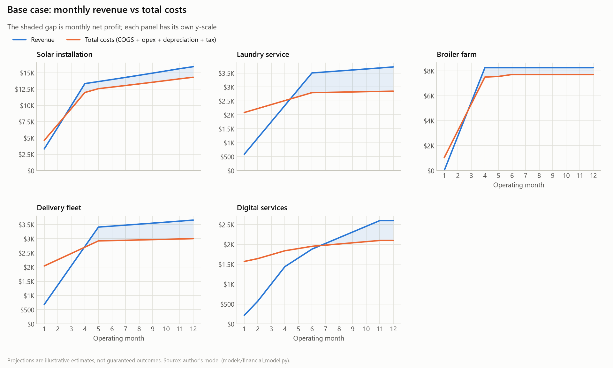
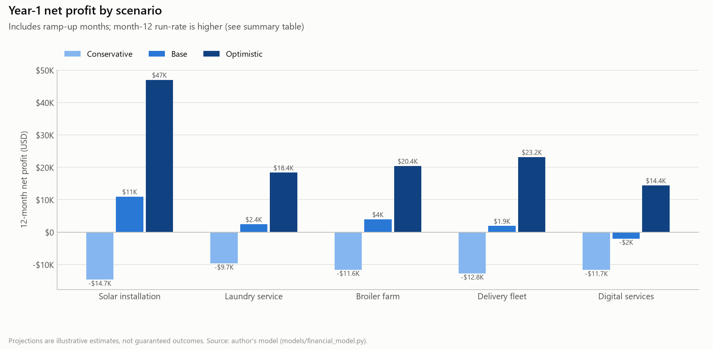

# Revenue and Profit Projections (12 Months)

[← Back to README](../README.md) · Related: [financial-assumptions.md](financial-assumptions.md) · [cash-flow-analysis.md](cash-flow-analysis.md) · [break-even-analysis.md](break-even-analysis.md)

> **[P] Financial projections.** All figures are outputs of [`models/financial_model.py`](../models/financial_model.py) under the assumptions in [financial-assumptions.md](financial-assumptions.md). They show what happens *if* those assumptions hold; they are **not guaranteed outcomes**.

## 1. Headline comparison (base case)

<!-- BEGIN TABLE: financial_comparison_base -->
| Business | Initial investment | Year-1 revenue | Gross margin | Year-1 net profit | Year-1 ROI | Month-12 run-rate ROI | Operating break-even month | Payback (months) |
|---|---|---|---|---|---|---|---|---|
| Solar installation | $17,013 | $151,561 | 32% | $10,983 | 65% | 114% | 3 | 12.4 |
| Laundry service | $15,656 | $34,039 | 81% | $2,440 | 16% | 67% | 5 | 18.4 |
| Broiler farm | $17,777 | $82,479 | 25% | $3,955 | 22% | 37% | 3 | 28.9 |
| Delivery fleet | $16,485 | $35,073 | 73% | $1,899 | 12% | 48% | 4 | 20.5 |
| Digital services | $8,505 | $20,923 | 86% | -$2,012 | -24% | 71% | 7 | 26.4 |
<!-- END TABLE: financial_comparison_base -->

*Year-1 ROI = year-1 net profit ÷ initial investment, including ramp-up months. Month-12 run-rate ROI = month-12 net profit × 12 ÷ initial investment, which shows steady-state earning power once ramp-up is over.*

**Reading the table**

- **Solar installation has by far the strongest base case.** It earns the most in absolute terms and pays back in about a year, because each sale carries a large absolute margin (≈ US$1,200 per 5 kVA system).
- **Laundry, delivery and broilers earn modest year-1 profits** (US$1,900–4,000). Their run-rate returns are respectable once ramp-up is complete.
- **Digital services loses money in year 1 in the base case.** Recurring retainer revenue builds slowly. Its run-rate return is good, but only *if* clients materialise as assumed, which is the least-evidenced assumption in the study.

## 2. Three scenarios

<!-- BEGIN TABLE: scenario_net_profit -->
| Business | Conservative | Base | Optimistic | Spread (optimistic - conservative) |
|---|---|---|---|---|
| Solar installation | -$14,673 | $10,983 | $47,006 | $61,679 |
| Laundry service | -$9,674 | $2,440 | $18,382 | $28,057 |
| Broiler farm | -$11,602 | $3,955 | $20,422 | $32,024 |
| Delivery fleet | -$12,759 | $1,899 | $23,176 | $35,935 |
| Digital services | -$11,684 | -$2,012 | $14,422 | $26,105 |
<!-- END TABLE: scenario_net_profit -->

**The most important number on this page is the conservative column.** In a realistic bad year, every business loses between about US$9,700 and US$14,700. In other words, each one is a genuine venture risk, and a large part of the capital can be lost. Solar has the widest spread: the most upside but also the largest conservative loss. It concentrates more revenue, and more imported cost, into each sale.

<b>Full scenario detail (all metrics)</b>

<!-- BEGIN TABLE: scenario_detail -->
| Business | Scenario | Year-1 revenue | Year-1 net profit | Year-1 ROI | Month-12 net profit | Run-rate ROI | Break-even month | Payback (months) |
|---|---|---|---|---|---|---|---|---|
| Solar installation | Conservative | $71,816 | -$14,673 | -86% | -$895 | -63% | not reached | not reached |
|  | Base | $151,561 | $10,983 | 65% | $1,621 | 114% | 3 | 12.4 |
|  | Optimistic | $265,848 | $47,006 | 276% | $5,414 | 382% | 1 | 6 |
| Laundry service | Conservative | $20,985 | -$9,674 | -62% | -$405 | -31% | not reached | > 60 |
|  | Base | $34,039 | $2,440 | 16% | $871 | 67% | 5 | 18.4 |
|  | Optimistic | $52,463 | $18,382 | 117% | $2,574 | 197% | 3 | 10 |
| Broiler farm | Conservative | $65,983 | -$11,602 | -65% | -$945 | -64% | not reached | not reached |
|  | Base | $82,479 | $3,955 | 22% | $546 | 37% | 3 | 28.9 |
|  | Optimistic | $108,590 | $20,422 | 115% | $2,052 | 139% | 2 | 10 |
| Delivery fleet | Conservative | $17,440 | -$12,759 | -77% | -$807 | -59% | not reached | not reached |
|  | Base | $35,073 | $1,899 | 12% | $654 | 48% | 4 | 20.5 |
|  | Optimistic | $59,423 | $23,176 | 141% | $2,866 | 209% | 2 | 9 |
| Digital services | Conservative | $9,252 | -$11,684 | -137% | -$626 | -88% | not reached | not reached |
|  | Base | $20,923 | -$2,012 | -24% | $500 | 71% | 7 | 26.4 |
|  | Optimistic | $40,855 | $14,422 | 170% | $2,253 | 318% | 3 | 9 |
<!-- END TABLE: scenario_detail -->

## 3. Monthly revenue (base case)

<!-- BEGIN TABLE: monthly_revenue_base -->
| Month | Solar installation | Laundry service | Broiler farm | Delivery fleet | Digital services |
|---|---|---|---|---|---|
| 1 | $3,312 | $584 | $0 | $682 | $214 |
| 2 | $6,624 | $1,168 | $2,749 | $1,364 | $571 |
| 3 | $9,981 | $1,752 | $5,499 | $2,046 | $1,005 |
| 4 | $13,339 | $2,336 | $8,248 | $2,728 | $1,439 |
| 5 | $13,650 | $2,920 | $8,248 | $3,410 | $1,660 |
| 6 | $13,965 | $3,504 | $8,248 | $3,444 | $1,880 |
| 7 | $14,287 | $3,539 | $8,248 | $3,478 | $2,024 |
| 8 | $14,613 | $3,575 | $8,248 | $3,513 | $2,168 |
| 9 | $14,946 | $3,610 | $8,248 | $3,548 | $2,311 |
| 10 | $15,284 | $3,647 | $8,248 | $3,584 | $2,455 |
| 11 | $15,628 | $3,683 | $8,248 | $3,620 | $2,598 |
| 12 | $15,932 | $3,720 | $8,248 | $3,656 | $2,598 |
<!-- END TABLE: monthly_revenue_base -->

## 4. Monthly profit and loss — base case, by business

Columns: revenue, cost of goods sold (COGS), gross profit, operating expenses (payroll incl. SSNIT, fixed and variable costs), depreciation & amortisation (D&A, incl. prepaid rent), net operating profit, tax, net profit, operating cash flow (net profit + D&A) and cumulative operating cash flow.

<b>Solar installation</b>

<!-- BEGIN TABLE: monthly_SOL_base -->
| Month | Revenue | COGS | Gross profit | Operating expenses | D&A | Net operating profit | Tax | Net profit | Operating cash flow | Cumulative cash flow |
|---|---|---|---|---|---|---|---|---|---|---|
| 1 | $3,312 | $2,260 | $1,052 | $1,939 | $435 | -$1,321 | $0 | -$1,321 | -$887 | -$887 |
| 2 | $6,624 | $4,519 | $2,105 | $2,105 | $435 | -$435 | $0 | -$435 | $0 | -$887 |
| 3 | $9,981 | $6,790 | $3,192 | $2,273 | $435 | $484 | $0 | $484 | $919 | $32 |
| 4 | $13,339 | $9,061 | $4,278 | $2,441 | $435 | $1,403 | $36 | $1,367 | $1,802 | $1,834 |
| 5 | $13,650 | $9,253 | $4,397 | $2,456 | $435 | $1,506 | $414 | $1,092 | $1,526 | $3,360 |
| 6 | $13,965 | $9,449 | $4,517 | $2,472 | $435 | $1,610 | $443 | $1,167 | $1,602 | $4,962 |
| 7 | $14,287 | $9,648 | $4,638 | $2,488 | $435 | $1,716 | $472 | $1,244 | $1,679 | $6,641 |
| 8 | $14,613 | $9,851 | $4,762 | $2,504 | $435 | $1,823 | $501 | $1,322 | $1,756 | $8,398 |
| 9 | $14,946 | $10,058 | $4,887 | $2,521 | $435 | $1,932 | $531 | $1,401 | $1,835 | $10,233 |
| 10 | $15,284 | $10,269 | $5,014 | $2,538 | $435 | $2,042 | $562 | $1,480 | $1,915 | $12,148 |
| 11 | $15,628 | $10,484 | $5,144 | $2,555 | $435 | $2,154 | $592 | $1,562 | $1,996 | $14,144 |
| 12 | $15,932 | $10,692 | $5,240 | $2,570 | $435 | $2,235 | $615 | $1,621 | $2,055 | $16,200 |
| **Year 1** | **$151,561** | $102,335 | $49,227 | $28,861 | $5,217 | $15,149 | $4,166 | **$10,983** | $16,200 |  |
<!-- END TABLE: monthly_SOL_base -->

<b>Laundry service</b>

<!-- BEGIN TABLE: monthly_LAU_base -->
| Month | Revenue | COGS | Gross profit | Operating expenses | D&A | Net operating profit | Tax | Net profit | Operating cash flow | Cumulative cash flow |
|---|---|---|---|---|---|---|---|---|---|---|
| 1 | $584 | $114 | $471 | $1,539 | $413 | -$1,481 | $18 | -$1,499 | -$1,086 | -$1,086 |
| 2 | $1,168 | $227 | $941 | $1,550 | $413 | -$1,022 | $35 | -$1,057 | -$644 | -$1,730 |
| 3 | $1,752 | $341 | $1,412 | $1,562 | $413 | -$564 | $53 | -$616 | -$203 | -$1,933 |
| 4 | $2,336 | $454 | $1,882 | $1,574 | $413 | -$105 | $70 | -$175 | $238 | -$1,695 |
| 5 | $2,920 | $568 | $2,353 | $1,586 | $413 | $354 | $88 | $267 | $679 | -$1,016 |
| 6 | $3,504 | $681 | $2,823 | $1,597 | $413 | $813 | $105 | $708 | $1,121 | $105 |
| 7 | $3,539 | $688 | $2,851 | $1,598 | $413 | $840 | $106 | $734 | $1,147 | $1,252 |
| 8 | $3,575 | $695 | $2,880 | $1,599 | $413 | $868 | $107 | $761 | $1,174 | $2,426 |
| 9 | $3,610 | $702 | $2,909 | $1,599 | $413 | $896 | $108 | $788 | $1,201 | $3,627 |
| 10 | $3,647 | $709 | $2,938 | $1,600 | $413 | $925 | $109 | $815 | $1,228 | $4,855 |
| 11 | $3,683 | $716 | $2,967 | $1,601 | $413 | $953 | $110 | $843 | $1,256 | $6,111 |
| 12 | $3,720 | $723 | $2,997 | $1,601 | $413 | $982 | $112 | $871 | $1,284 | $7,395 |
| **Year 1** | **$34,039** | $6,617 | $27,422 | $19,006 | $4,955 | $3,461 | $1,021 | **$2,440** | $7,395 |  |
<!-- END TABLE: monthly_LAU_base -->

<b>Broiler farm</b>

<!-- BEGIN TABLE: monthly_BRO_base -->
| Month | Revenue | COGS | Gross profit | Operating expenses | D&A | Net operating profit | Tax | Net profit | Operating cash flow | Cumulative cash flow |
|---|---|---|---|---|---|---|---|---|---|---|
| 1 | $0 | $0 | $0 | $876 | $160 | -$1,036 | $0 | -$1,036 | -$876 | -$876 |
| 2 | $2,749 | $2,057 | $692 | $972 | $160 | -$440 | $0 | -$440 | -$280 | -$1,155 |
| 3 | $5,499 | $4,114 | $1,385 | $1,068 | $160 | $157 | $0 | $157 | $317 | -$839 |
| 4 | $8,248 | $6,171 | $2,077 | $1,164 | $160 | $753 | $0 | $753 | $913 | $74 |
| 5 | $8,248 | $6,171 | $2,077 | $1,164 | $160 | $753 | $51 | $701 | $861 | $935 |
| 6 | $8,248 | $6,171 | $2,077 | $1,164 | $160 | $753 | $207 | $546 | $706 | $1,641 |
| 7 | $8,248 | $6,171 | $2,077 | $1,164 | $160 | $753 | $207 | $546 | $706 | $2,347 |
| 8 | $8,248 | $6,171 | $2,077 | $1,164 | $160 | $753 | $207 | $546 | $706 | $3,052 |
| 9 | $8,248 | $6,171 | $2,077 | $1,164 | $160 | $753 | $207 | $546 | $706 | $3,758 |
| 10 | $8,248 | $6,171 | $2,077 | $1,164 | $160 | $753 | $207 | $546 | $706 | $4,463 |
| 11 | $8,248 | $6,171 | $2,077 | $1,164 | $160 | $753 | $207 | $546 | $706 | $5,169 |
| 12 | $8,248 | $6,171 | $2,077 | $1,164 | $160 | $753 | $207 | $546 | $706 | $5,875 |
| **Year 1** | **$82,479** | $61,709 | $20,769 | $13,394 | $1,920 | $5,455 | $1,500 | **$3,955** | $5,875 |  |
<!-- END TABLE: monthly_BRO_base -->

<b>Delivery fleet</b>

<!-- BEGIN TABLE: monthly_DEL_base -->
| Month | Revenue | COGS | Gross profit | Operating expenses | D&A | Net operating profit | Tax | Net profit | Operating cash flow | Cumulative cash flow |
|---|---|---|---|---|---|---|---|---|---|---|
| 1 | $682 | $183 | $499 | $1,396 | $440 | -$1,337 | $20 | -$1,357 | -$918 | -$918 |
| 2 | $1,364 | $366 | $998 | $1,413 | $440 | -$855 | $41 | -$896 | -$456 | -$1,374 |
| 3 | $2,046 | $550 | $1,496 | $1,430 | $440 | -$373 | $61 | -$435 | $5 | -$1,369 |
| 4 | $2,728 | $733 | $1,995 | $1,447 | $440 | $108 | $82 | $26 | $466 | -$903 |
| 5 | $3,410 | $916 | $2,494 | $1,464 | $440 | $590 | $102 | $488 | $927 | $24 |
| 6 | $3,444 | $925 | $2,519 | $1,465 | $440 | $614 | $103 | $511 | $951 | $975 |
| 7 | $3,478 | $934 | $2,544 | $1,466 | $440 | $638 | $104 | $534 | $974 | $1,949 |
| 8 | $3,513 | $944 | $2,570 | $1,467 | $440 | $663 | $105 | $558 | $997 | $2,946 |
| 9 | $3,548 | $953 | $2,595 | $1,468 | $440 | $688 | $106 | $581 | $1,021 | $3,967 |
| 10 | $3,584 | $963 | $2,621 | $1,469 | $440 | $713 | $108 | $605 | $1,045 | $5,012 |
| 11 | $3,620 | $972 | $2,647 | $1,469 | $440 | $738 | $109 | $630 | $1,069 | $6,082 |
| 12 | $3,656 | $982 | $2,674 | $1,470 | $440 | $764 | $110 | $654 | $1,094 | $7,176 |
| **Year 1** | **$35,073** | $9,421 | $25,652 | $17,425 | $5,276 | $2,951 | $1,052 | **$1,899** | $7,176 |  |
<!-- END TABLE: monthly_DEL_base -->

<b>Digital services</b>

<!-- BEGIN TABLE: monthly_DIG_base -->
| Month | Revenue | COGS | Gross profit | Operating expenses | D&A | Net operating profit | Tax | Net profit | Operating cash flow | Cumulative cash flow |
|---|---|---|---|---|---|---|---|---|---|---|
| 1 | $214 | $26 | $188 | $1,412 | $126 | -$1,350 | $6 | -$1,356 | -$1,231 | -$1,231 |
| 2 | $571 | $69 | $502 | $1,430 | $126 | -$1,054 | $17 | -$1,071 | -$945 | -$2,176 |
| 3 | $1,005 | $133 | $872 | $1,451 | $126 | -$706 | $30 | -$736 | -$610 | -$2,786 |
| 4 | $1,439 | $197 | $1,242 | $1,473 | $126 | -$357 | $43 | -$400 | -$274 | -$3,060 |
| 5 | $1,660 | $236 | $1,424 | $1,484 | $126 | -$186 | $50 | -$236 | -$110 | -$3,170 |
| 6 | $1,880 | $274 | $1,606 | $1,495 | $126 | -$15 | $56 | -$71 | $55 | -$3,115 |
| 7 | $2,024 | $292 | $1,732 | $1,502 | $126 | $104 | $61 | $43 | $169 | -$2,946 |
| 8 | $2,168 | $310 | $1,857 | $1,509 | $126 | $222 | $65 | $157 | $283 | -$2,663 |
| 9 | $2,311 | $328 | $1,983 | $1,516 | $126 | $341 | $69 | $272 | $397 | -$2,265 |
| 10 | $2,455 | $346 | $2,109 | $1,523 | $126 | $460 | $74 | $386 | $512 | -$1,754 |
| 11 | $2,598 | $364 | $2,234 | $1,530 | $126 | $578 | $78 | $500 | $626 | -$1,128 |
| 12 | $2,598 | $364 | $2,234 | $1,530 | $126 | $578 | $78 | $500 | $626 | -$502 |
| **Year 1** | **$20,923** | $2,941 | $17,982 | $17,856 | $1,510 | -$1,384 | $628 | **-$2,012** | -$502 |  |
<!-- END TABLE: monthly_DIG_base -->

All scenarios, all months and all line items are in [`data/datasets/outputs/monthly_projections.csv`](../data/datasets/outputs/monthly_projections.csv).
