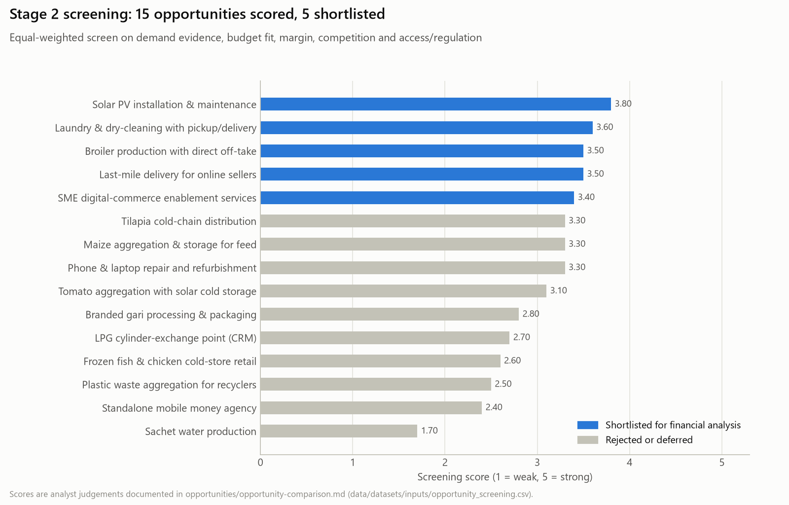

# Stage 2 — Opportunity Screening and Comparison

[← Back to README](../README.md) · Previous: [opportunity-identification.md](opportunity-identification.md) · Next: [shortlisted-businesses.md](shortlisted-businesses.md)

> **Result:** Of 15 opportunities profiled, **5 were shortlisted** for financial modelling, **1 was held as first reserve**, **3 were deferred** and **6 were rejected**. **Four of the five shortlisted businesses stay in the top five under every alternative weighting tested.** The fifth slot is contested and is disclosed as such (section 4).

## 1. Method recap

Full method: [research-methodology.md §5](../research/research-methodology.md#5-opportunity-screening-method-stage-2). In short:

1. **Hard gates:** an opportunity fails if it cannot reach a minimum viable scale for ≤ US$20,000 (budget gate) or if no credible demand evidence exists (evidence gate).
2. **Five equally weighted criteria**, each scored 1–5: demand evidence, budget fit, margin potential, competitive intensity (5 = least intense) and access & regulation (5 = simple licensing, open to all investors).
3. **Ranking** by mean score. Ties are broken by demand evidence, the criterion that carries the highest weight in the final model.

Scores are analyst judgements anchored on the evidence IDs listed in [opportunity_screening.csv](../data/datasets/inputs/opportunity_screening.csv). The script [scoring_model.py](../models/scoring_model.py) checks that every score is the mean of its criteria and re-runs the screen under alternative weights.

## 2. Screening matrix

| Rank | ID | Opportunity | Demand | Budget | Margin | Competition | Access | **Score** | Gate | Decision |
|---|---|---|---|---|---|---|---|---|---|---|
| 1 | O01 | Solar PV installation & maintenance | 5 | 4 | 4 | 3 | 3 | **3.8** | Pass | ✅ Shortlisted |
| 2 | O04 | Laundry & dry-cleaning with pickup | 3 | 4 | 4 | 3 | 4 | **3.6** | Pass | ✅ Shortlisted |
| 3 | O03 | Broiler production with direct off-take | 5 | 4 | 2 | 2.5 | 4 | **3.5** | Pass | ✅ Shortlisted |
| 4 | O02 | Last-mile delivery for online sellers | 4 | 5 | 3 | 2.5 | 3 | **3.5** | Pass | ✅ Shortlisted |
| 5 | O05 | SME digital-commerce enablement | 2 | 5 | 3 | 2 | 5 | **3.4** | Pass | ✅ Shortlisted |
| 6 | O06 | Tilapia cold-chain distribution | 4 | 4 | 3 | 3 | 2.5 | **3.3** | Pass | 🔶 First reserve |
| 7 | O07 | Maize aggregation & storage | 3.5 | 3 | 3 | 3 | 4 | **3.3** | Pass | ⏸ Deferred |
| 8 | O11 | Phone & laptop repair | 3 | 5 | 3 | 1.5 | 4 | **3.3** | Pass | ❌ Rejected |
| 9 | O08 | Tomato solar cold storage | 4 | 2 | 2 | 4 | 3.5 | **3.1** | Borderline | ⏸ Deferred |
| 10 | O09 | Branded gari processing | 3 | 4 | 2 | 2 | 3 | **2.8** | Pass | ❌ Rejected |
| 11 | O10 | LPG cylinder-exchange point | 4 | 2.5 | 2 | 3 | 2 | **2.7** | Borderline | ⏸ Deferred |
| 12 | O12 | Frozen fish & chicken cold store | 3 | 4 | 2 | 2 | 2 | **2.6** | Pass | ❌ Rejected |
| 13 | O13 | Plastic waste aggregation | 1.5 | 4 | 1 | 3 | 3 | **2.5** | Pass | ❌ Rejected |
| 14 | O14 | Standalone mobile money agency | 2 | 5 | 1 | 1 | 3 | **2.4** | Pass | ❌ Rejected |
| 15 | O15 | Sachet water production | 2.5 | 2 | 2 | 1 | 1 | **1.7** | **Fail (budget)** | ❌ Rejected |

## 3. Why the top scores are what they are

| Opportunity | Strongest evidence | Weakest point (what pulled the score down) |
|---|---|---|
| **Solar (3.8)** | Documented outages in 2024, 2025 and 2026; quarterly tariff increases; only 7.6 MW of small residential PV installed (ENE-03–13) | Technical licensing and imported, FX-exposed inputs (access 3); a crowded online price market (competition 3) |
| **Laundry (3.6)** | High service margins; urbanisation; new entrants scaling (SVC-13) | Demand evidence is largely anecdotal (demand 3) |
| **Broiler (3.5)** | Strongest import-substitution evidence in the study (AGR-01–03) | Feed ~70% of cost and a frozen-import price ceiling (margin 2); subsidised Nkoko flocks plus imports (competition 2.5) |
| **Delivery (3.5)** | Digital adoption, social-commerce growth and legalised motorbike couriers (ENE-23, 29, 31–35) | Price competition from platforms and informal riders (competition 2.5); evolving rider regulation (access 3) |
| **Digital services (3.4)** | Large gap between consumer and merchant digital adoption (ENE-40, MAC-04) | No evidence that micro-firms will pay (demand 2); very low barriers to entry (competition 2) |

## 4. Robustness: does the shortlist depend on the weights?

The screen was re-run under three alternative weightings (output: [screening_robustness.csv](../data/datasets/outputs/screening_robustness.csv)).

| Variant | Top five | Change vs method used |
|---|---|---|
| **Equal weights (method used)** | O01, O04, O03, O02, **O05** | — |
| Demand double-weighted | O01, O03, O02, O04, **O06** | Tilapia replaces digital services |
| Local investor only (access criterion excluded) | O01, O02, O06, O04, O03 | Tilapia replaces digital services |
| Margin double-weighted | O01, O04, O02, O05, O03 | No change in membership |

**Interpretation**

- **Solar, laundry, broiler and delivery are robust.** They stay in the top five under every variant.
- **The fifth slot is genuinely contested** between SME digital services (O05) and tilapia distribution (O06). O05 is kept because it wins under the method declared before scoring; changing the method after seeing the results would be cherry-picking. It also adds a capital-light, digital business model to the comparison. O06 is carried as **first reserve** and is recommended for the same primary-validation sprint (see [final-recommendation.md](../strategic-analysis/final-recommendation.md)).
- **For a foreign investor**, the local-investor variant is irrelevant, and O06 becomes harder because cold-chain fish distribution is a trading activity (US$500k equity under Act 1173, REG-05).

## 5. Rejected and deferred — the evidence-based reasons

| Opportunity | Decision | Evidence-based reason |
|---|---|---|
| Sachet water | ❌ Reject | Fails the budget gate (US$25–60k). Saturated: 1,200+ brands; recommended ex-factory price fixed at GHS 8 per bag; **reserved for Ghanaians** (SVC-20, SVC-21, SVC-30). |
| Mobile money agency | ❌ Reject | Only 46% of registered agents active; commissions ~0.4–1% of cash-out value (SVC-24). Viable only as an add-on to a shop. |
| Plastic waste aggregation | ❌ Reject | Bale prices fell ~71% in Kumasi in 2026; buyers take clear PET only; EPR law still in draft (SVC-17, SVC-18). |
| Frozen-food cold store | ❌ Reject | Saturated, thin margins; FDA enforcement in 2026; market/petty trading reserved for Ghanaians (SVC-21, SVC-30). |
| Branded gari | ❌ Reject | Commodity pricing anchored by a GHS 10/kg floor; established brands; no export data found (AGR-15). |
| Phone/laptop repair | ❌ Reject | Saturated repair clusters; low differentiation (SVC-29). |
| Maize aggregation | ⏸ Defer | Real link to feed costs, but meaningful volume needs >US$20k of stock, and the 2025 national surplus (AGR-22) may compress the seasonal spread. Revisit as a backward-integration step for a poultry business. |
| Tomato cold storage | ⏸ Defer | Strong loss evidence (AGR-23), but the cold room absorbs most of the budget and willingness to pay for storage is unproven. A candidate for grant or blended finance rather than a US$20k equity play. |
| LPG cylinder exchange | ⏸ Defer | The CRM roll-out is still being implemented and distributor appointments are controlled by bottlers (ENE-38, ENE-39). Revisit in 2027 once the channel rules settle. |

## 6. What the screen tells us about the market

1. **The best small-capital opportunities are services wrapped around infrastructure gaps** (power, logistics, laundry) rather than manufacturing. Manufacturing import substitution (tomato paste, rice milling, feed milling) needs capital well above US$20,000.
2. **Agriculture has the strongest demand evidence but the weakest unit economics at small scale.** Broilers are shortlisted to test this explicitly in the financial model.
3. **Saturation is the main reason for rejection.** Ghana's informal economy (92.3% of establishments, MAC-20) already fills most low-barrier niches. An entrant needs a quality or reliability edge, not just presence.
4. **Foreign-investor access narrows the field.** Trading formats (cold stores, fish distribution, retail) are effectively closed below US$500k, and several consumer formats are reserved (REG-05). See [country-overview.md](../research/country-overview.md#4-rules-for-foreign-investors).
