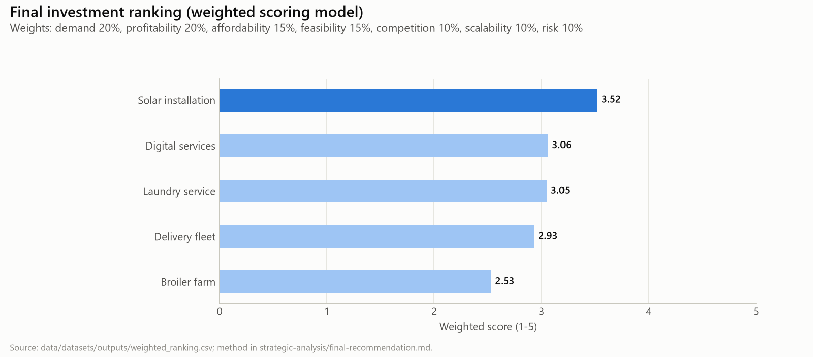

# Final Investment Ranking and Recommendation

[← Back to README](../README.md) · Related: [executive-summary.md](../executive-summary/executive-summary.md) · [risk-assessment.md](risk-assessment.md) · [financial-analysis/](../financial-analysis/)

> **Recommendation:** Prioritise **Solar PV installation & maintenance** for a Ghanaian (or resident) owner-operator with access to a certified electrician. Invest in **two stages behind a 6-week validation sprint**, use **deposit-before-purchase and USD-indexed quotes** to control the main risk (FX), and hold a reserve of about **US$5,800** for the conservative case.
>
> **Laundry service** is the recommended alternative for risk-averse investors and for **foreign investors** (as a joint venture). **Broiler grow-out is not recommended** at this budget unless off-take is pre-sold.
>
> All projections are conditional estimates **[P]**, not guaranteed returns.

---

## 1. Scoring methodology

Seven criteria, with the weights from the project brief. Each criterion is scored 1 (worst) to 5 (best). **Three criteria are calculated by formula from model outputs, so they cannot be tuned by hand:**

| Criterion | Weight | How it is scored | Type |
|---|---|---|---|
| Market demand | 20% | Strength and quality of evidence for **paying** demand | Analyst, with rationale |
| Investment affordability | 15% | Linear: US$5,000 → 5; US$20,000 → 1 | **Formula** |
| Profitability potential | 20% | Linear on base-case month-12 run-rate ROI: ≤ 0% → 1; ≥ 150% → 5 | **Formula** |
| Competitive intensity | 10% | 5 = least intense ([competitor-analysis.md](competitor-analysis.md), [industry-analysis.md](../research/industry-analysis.md)) | Analyst, with rationale |
| Operational feasibility | 15% | Skills, licensing, supply chain, execution complexity | Analyst, with rationale |
| Scalability | 10% | Ability to grow without proportional new capital | Analyst, with rationale |
| Risk level | 10% | Linear on mean L × I risk score: ≤ 4 → 5; ≥ 16 → 1 ([risk-assessment.md](risk-assessment.md)) | **Formula** |

Implementation: [`models/scoring_model.py`](../models/scoring_model.py); weights in [`scoring_weights.csv`](../data/datasets/inputs/scoring_weights.csv).

### Formula-based scores

<!-- BEGIN TABLE: derived_scores -->
| Business | Investment affordability | Profitability potential | Risk level |
|---|---|---|---|
| Solar installation | 1.80 — Initial investment $17,013 | 4.05 — Base-case month-12 run-rate ROI 114% | 2.90 — Mean risk-register score 10.3 / 25 |
| Digital services | 4.07 — Initial investment $8,505 | 2.88 — Base-case month-12 run-rate ROI 71% | 3.71 — Mean risk-register score 7.9 / 25 |
| Laundry service | 2.16 — Initial investment $15,656 | 2.78 — Base-case month-12 run-rate ROI 67% | 3.67 — Mean risk-register score 8.0 / 25 |
| Delivery fleet | 1.94 — Initial investment $16,485 | 2.27 — Base-case month-12 run-rate ROI 48% | 2.86 — Mean risk-register score 10.4 / 25 |
| Broiler farm | 1.59 — Initial investment $17,777 | 1.98 — Base-case month-12 run-rate ROI 37% | 2.43 — Mean risk-register score 11.7 / 25 |
<!-- END TABLE: derived_scores -->

<b>Analyst-scored criteria with rationale</b>

<!-- BEGIN TABLE: qualitative_scores -->
| Business | Criterion | Score | Rationale |
|---|---|---|---|
| Solar installation | Competitive intensity | 3 | Fragmented market with price-led online sellers and few certified, service-led installers in the mid-market; large players focus on PAYG or C&I segments |
| Solar installation | Market demand | 5 | Outages documented in 2024, 2025 and 2026; grid tariffs reset quarterly; only 7.6 MW of small residential PV installed against a 214 MW distributed target; US$200m rooftop programme |
| Solar installation | Operational feasibility | 3 | Requires a certified electrician, supplier relationships and technical liability management; equipment is bought per order after deposits |
| Solar installation | Scalability | 4 | Add installation crews; SME and institutional contracts; bank and programme-financed customers |
| Digital services | Competitive intensity | 2 | Very low barriers to entry; freelancers and do-it-yourself tools |
| Digital services | Market demand | 2 | Clear gap between consumer and merchant digital adoption, but no evidence that micro-firms will pay recurring fees |
| Digital services | Operational feasibility | 4 | Low capex and widely available skills; client acquisition is the hard part |
| Digital services | Scalability | 3 | People-bound service; productised packages and training improve leverage |
| Laundry service | Competitive intensity | 3 | Large informal segment plus a handful of organised players; reliability is the main gap cited by operators |
| Laundry service | Market demand | 3 | Urbanisation and new entrants scaling (24-hour facility, Oct 2026), but demand evidence is mostly operator claims |
| Laundry service | Operational feasibility | 4 | Simple processes and readily trained staff; utilities (power and water) are the main operating constraint |
| Laundry service | Scalability | 3 | Hub-and-spoke collection points and B2B contracts allow growth, but each hub needs new equipment |
| Delivery fleet | Competitive intensity | 2.5 | Platforms (Yango, Bolt) and many informal riders; gap in reliable B2B service with fast cash settlement |
| Delivery fleet | Market demand | 4 | Online and social commerce growing (Bolt non-restaurant orders +154%; 28.8m internet users); demand for reliable COD delivery from micro-sellers |
| Delivery fleet | Operational feasibility | 3 | Rider management, cash control and new licensing and union rules add execution complexity |
| Delivery fleet | Scalability | 4 | Fleet grows per contract; model can be replicated in Kumasi and Takoradi |
| Broiler farm | Competitive intensity | 2 | Frozen imports, subsidised programme flocks and integrated farms all compete for the same buyers |
| Broiler farm | Market demand | 4 | Import substitution evidence is the strongest in the study, but paying demand at local cost is constrained: local birds cost about twice frozen imports per kg and off-take problems were reported in 2026 (downgraded from 5 at screening) |
| Broiler farm | Operational feasibility | 3 | Husbandry skill, biosecurity, land and water access needed; feed management decides profitability |
| Broiler farm | Scalability | 2 | Growth needs new housing and working capital per bird; biosecurity limits density |
<!-- END TABLE: qualitative_scores -->

## 2. Ranking

<!-- BEGIN TABLE: weighted_ranking -->
| Rank | Business | Market demand | Investment affordability | Profitability potential | Competitive intensity | Operational feasibility | Scalability | Risk level | Weighted score |
|---|---|---|---|---|---|---|---|---|---|
| 1 | Solar installation | 5.00 | 1.80 | 4.05 | 3.00 | 3.00 | 4.00 | 2.90 | **3.52** |
| 2 | Digital services | 2.00 | 4.07 | 2.88 | 2.00 | 4.00 | 3.00 | 3.71 | **3.06** |
| 3 | Laundry service | 3.00 | 2.16 | 2.78 | 3.00 | 4.00 | 3.00 | 3.67 | **3.05** |
| 4 | Delivery fleet | 4.00 | 1.94 | 2.27 | 2.50 | 3.00 | 4.00 | 2.86 | **2.93** |
| 5 | Broiler farm | 4.00 | 1.59 | 1.98 | 2.00 | 3.00 | 2.00 | 2.43 | **2.53** |
<!-- END TABLE: weighted_ranking -->

### Robustness: does the ranking depend on the weights?

The ranking was recomputed with **equal weights** and with a **risk-averse** set (risk 25%, scalability 5%):

<!-- BEGIN TABLE: ranking_robustness -->
| Business | Recommended weights | Equal weights | Risk averse weights |
|---|---|---|---|
| Solar installation | #1 (3.52) | #1 (3.39) | #1 (3.30) |
| Digital services | #2 (3.06) | #2 (3.09) | #2 (3.22) |
| Laundry service | #3 (3.05) | #3 (3.09) | #3 (3.16) |
| Delivery fleet | #4 (2.93) | #4 (2.94) | #4 (2.85) |
| Broiler farm | #5 (2.53) | #5 (2.43) | #5 (2.49) |
<!-- END TABLE: ranking_robustness -->

**The order is identical under all three weight sets, but the size of solar's lead is not.** It is 0.46 points with the brief's weights and 0.30 with equal weights, but only **0.08 with risk-averse weights**. Solar wins because of demand and profitability. An investor who weights risk heavily should treat solar, digital services and laundry as close alternatives, which is why section 7 gives profile-specific advice. **Positions 2 and 3 are effectively tied** under every weight set (0.00–0.06 apart).

## 3. Why solar installation deserves priority

| Test | Solar's result | Evidence |
|---|---|---|
| Is demand real and growing? | Strongest in the study: outages in each of 2024–2026, quarterly tariff resets, low installed base, new bank loan products | ENE-03–14, ENE-46, ENE-47 |
| Does it make money? | Best base case: ~US$11.0k year-1 net profit, ~114% month-12 run-rate ROI, payback ≈ 12 months | [revenue-projections.md](../financial-analysis/revenue-projections.md) |
| Is the industry structure favourable? | Best Five Forces profile (3.2). Information asymmetry rewards trusted installers | [industry-analysis.md](../research/industry-analysis.md) |
| Is the environment supportive? | Strongest PESTLE tailwind (+15) | [pestle-analysis.md](pestle-analysis.md) |
| Can a US$5–20k entrant win? | Yes: the market gap is about trust and service, not capital. Customer deposits fund equipment | [competitor-analysis.md](competitor-analysis.md) |
| Are the main risks controllable? | **Mostly:** FX and pricing can be managed with deposits and indexed quotes; demand can be tested before full investment | [risk-assessment.md](risk-assessment.md) |

### What could go wrong (and how large it is)

- **FX:** a 20% cedi depreciation without re-pricing would cut year-1 profit by ~US$16.2k. **Mitigation:** quote in GHS indexed to USD with 7-day validity, and buy only after a 70% deposit. Under this policy, most FX risk passes to the customer at the time of quote.
- **Price and cost:** contribution margin is only ~28%, so a 20% price cut erases year-1 profit more than twice over. **Mitigation:** mid-market positioning on service and warranty; never compete with marketplace kits on price.
- **Downside case:** conservative year-1 loss of ~US$14.7k and a cash shortfall of ~US$5.8k by month 12. **Mitigation:** stage gates and stop-loss rules (section 6).
- **Key-person dependency** on a certified electrician. **Mitigation:** the owner obtains certification, or a technician receives profit-share or equity.

## 4. Business Model Canvas — solar installation

| Key partners | Key activities | Value proposition | Customer relationships | Customer segments |
|---|---|---|---|---|
| Energy Commission-registered equipment distributors (2 per component) · Banks: Ecobank ASAP, Stanbic Be Powered (ENE-46, ENE-47) · Manufacturer training programmes · SME trade associations | Site surveys and sizing · Installation and commissioning · Maintenance visits · USD-indexed quoting and procurement after deposit · Lead generation | **"Certified, warrantied backup power at a mid-market price — with financing."** Business continuity for SMEs during outages · Transparent fixed-price packages · 5-year workmanship warranty | Site survey (GHS 300, credited on purchase) · WhatsApp support line · Annual maintenance plans · Referral rewards | **1. Power-dependent SMEs** (pharmacies, cold-drink sellers, salons, printers, clinics) · **2. Middle-income homeowners** · 3. Schools, churches, small hotels |
| | **Key resources** | | **Channels** | |
| | Certified lead technician · Energy Commission licences · Live demonstration system · Tools, tricycle · Supplier credit · Installation portfolio and testimonials | | Direct field sales to SMEs · Showroom · Facebook/TikTok/WhatsApp · Bank-partner referrals · Customer referrals | |

| Cost structure | Revenue streams |
|---|---|
| Equipment (~68% of revenue, USD-linked) · Payroll incl. SSNIT (~US$1,230/month) · Rent (prepaid) · Marketing · Tricycle running costs · Warranty provision 2% · CIT 25% + GSL 2.5% | 5 kVA systems (~GHS 44k ex-VAT) · 3 kVA systems (~GHS 30k ex-VAT) · Maintenance visits (GHS 600) · Future: battery upgrades, SME service contracts |

## 5. Implementation roadmap

| Phase | Timing | Key actions | Capital released |
|---|---|---|---|
| **0. Validation sprint** | Weeks 1–6 | Register company; start Energy Commission certification/licensing; get 3 supplier quotes; interview 30 SMEs; run 10 site surveys; approach 2 banks for a referral partnership | ~US$2,000–3,000 (registration, marketing, surveys) |
| **Gate 1** | Week 6 | **≥ 3 paid deposits** and supplier terms agreed → proceed | — |
| **1. Launch** | Months 1–3 | Showroom and demonstration system; first installations; testimonial content; referral programme | Remainder of the ~US$17.0k budget |
| **Gate 2** | Month 4 | **≥ 2 systems/month** average and gross margin ≥ 28% → continue | — |
| **2. Stabilise** | Months 4–6 | Launch maintenance plans; SME packages; bank-financed sales | From cash flow |
| **3. Scale** | Months 7–12 | Second crew once demand is **≥ 6 systems/month** for two months; apply for rooftop-programme installer lists (ENE-14) | From cash flow |

## 6. Stage gates and stop-loss rules

Decision rules agreed **before** investing protect the investor from the conservative case, in which every shortlisted business runs out of cash within 12 months ([cash-flow-analysis.md](../financial-analysis/cash-flow-analysis.md)).

| Business | Continue if… | Stop or pivot if… | Pivot option |
|---|---|---|---|
| **Solar installation** | ≥ 3 deposits by week 6; ≥ 2 systems/month by month 4 | < 1.5 systems/month for 3 consecutive months, **or** cumulative cash flow below −US$4,000 by month 6 | Asset-light installation subcontracting for retailers (e.g., marketplace sellers) |
| Laundry service | ≥ 60 paying trial customers by week 6; ≥ 30 kg/day by month 4 | < 25 kg/day by month 6 | Convert to B2B-only hostel and linen service |
| Broiler farm | One batch ≥ 80% pre-sold at ≥ GHS 105 | Realised price < GHS 95 for two batches | Contract growing for a processor (AGR-37) |
| Delivery fleet | ≥ 10 contracted sellers; ≥ 15 drops/bike/day by month 4 | < 10 drops/bike/day by month 5 | Sell two bikes; run as a two-bike niche service |
| Digital services | ≥ 5 paying retainers by week 6 | < 8 retainers by month 6 | Freelance project work only |

## 7. Recommendation by investor profile

| Investor profile | Recommended option | Why |
|---|---|---|
| **Ghanaian owner-operator with electrical skills or a certified partner** | **Solar installation** | Best evidence and economics; risks manageable operationally |
| Ghanaian investor, risk-averse, no technical partner | **Laundry service** | No FX exposure; highest contribution margin; simple operations; smallest conservative-case funding gap (~US$1.6k) |
| **Foreign investor** (non-resident) | **Laundry service as a JV** with a Ghanaian operator (≈ US$19.2k incl. GIPA fee), or **digital services** (≈ US$13.8k even wholly foreign) | Non-trading, not reserved, no minimum capital under Act 1173. Solar risks "trading" classification (US$500k), so get a legal opinion first |
| Investor who wants the lowest capital at risk | **Digital services**, as a pilot | ~US$8.5k; but test willingness to pay with 5 paying clients before committing |
| Investor drawn to agriculture | **Do not start broiler grow-out at this budget.** Consider the **first reserve, tilapia cold-chain distribution**, after a validation study, or broilers only with contracted off-take | Price ceiling from imports; feed and disease risk; 2026 glut |

## 8. What would change this recommendation

| Development | Effect |
|---|---|
| Validation sprint produces < 3 solar deposits | Switch to laundry (next-best risk-adjusted option) |
| 2027 duty/VAT exemption on panels and batteries becomes law (REG-18) | **Positive for solar demand** (lower system prices), but buyers may wait for it. Avoid holding stock before the effective date |
| Cedi stabilises or appreciates | Solar margins improve; the FX stress test becomes less relevant |
| Poultry import restrictions introduced (targeted for 2028 if self-sufficiency reaches ~60%, AGR-38) | Broiler economics improve materially. Revisit |
| Digital pilot secures ≥ 5 paying retainers within 6 weeks | Digital services moves from "pilot" to "invest" |
| GIPA publishes regulations clarifying "trading" | Re-assess foreign eligibility for solar |

## 9. Limitations of this recommendation

1. **Based on secondary research only.** No customer interviews, supplier quotations or site visits. The validation sprint exists to close this gap.
2. **Several key inputs are assumptions** (conversion rates, ramp-up speed, solar unit volumes, laundry usage rates). They are labelled throughout and stress-tested.
3. **Twelve-month horizon.** Equipment-heavy businesses (laundry, delivery) look better over a 3-year horizon than in year 1.
4. **Scores for four criteria are analyst judgements.** They are documented with rationale and evidence, and the ranking is robust to the weights, but a different analyst could score differently.
