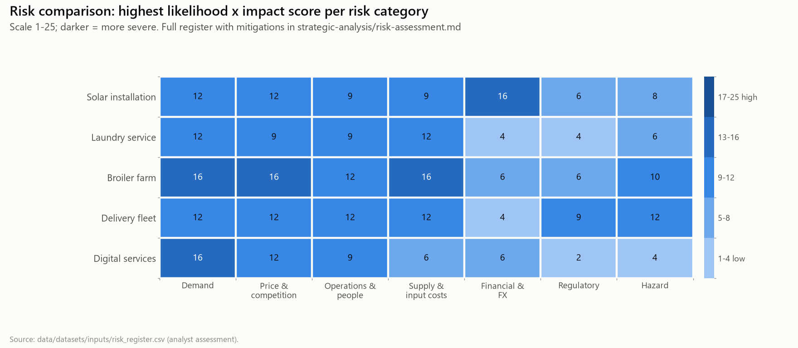

# Risk Assessment

[← Back to README](../README.md) · Related: [pestle-analysis.md](pestle-analysis.md) · [swot-analysis.md](swot-analysis.md) · [break-even-analysis.md](../financial-analysis/break-even-analysis.md) · [final-recommendation.md](final-recommendation.md)

> **Method:** Each business has seven risks, one per category (demand, price & competition, operations & people, supply & input costs, financial & FX, regulatory, hazard). Each is scored for **likelihood (L, 1–5)** and **impact (I, 1–5)**; **score = L × I (1–25)**. Scores of 12 or more are bold. The register lives in [`risk_register.csv`](../data/datasets/inputs/risk_register.csv). Its mean score feeds the "risk level" criterion in the [weighted ranking](final-recommendation.md) by formula. Scores are analyst judgements anchored on the cited evidence and on the [sensitivity analysis](../financial-analysis/break-even-analysis.md#2-sensitivity-analysis).

## 1. Risk summary

<!-- BEGIN TABLE: risk_summary -->
| Business | Mean score (1-25) | Highest score | Risks scored 12 or more | Top risk |
|---|---|---|---|---|
| Solar installation | 10.3 | 16 | 3 | Cedi depreciation raises equipment cost between quote and purchase |
| Laundry service | 8.0 | 12 | 2 | Customer acquisition slower than plan in the chosen neighbourhood |
| Broiler farm | 11.7 | 16 | 4 | Birds cannot be sold at market age; holding costs rise (reported for programme beneficiaries in 2026) |
| Delivery fleet | 10.4 | 12 | 5 | Seller volumes below plan |
| Digital services | 7.9 | 16 | 2 | Micro and small firms will not pay monthly retainers |
<!-- END TABLE: risk_summary -->

**Interpretation**

- **Broiler production is the highest-risk business.** Three risks score 16 (off-take, the import price ceiling and feed costs), and disease carries the highest impact rating in the study (5). Most of these are outside a small farm's control.
- **Solar's risk is concentrated in one category, FX**, which can be reduced operationally (USD-indexed quotes, deposits before purchase). The register scores the risk **before** mitigation. The sensitivity analysis shows why it matters: −US$16.2k year-1 impact without re-pricing.
- **Digital services has the lowest average risk but the single most fundamental one:** demand (score 16). An average can hide a fatal risk, which is why both the mean and the maximum are shown.

## 2. Risk registers by business

<b>Solar installation</b>

<!-- BEGIN TABLE: risk_register_SOL -->
| ID | Category | Risk | L | I | Score | Mitigation | Evidence |
|---|---|---|---|---|---|---|---|
| SOL-R5 | Financial & FX | Cedi depreciation raises equipment cost between quote and purchase | 4 | 4 | **16** | 7-day quote validity; 70% deposit triggers purchase; reprice weekly; sensitivity test shows impact | MAC-06, MAC-07 |
| SOL-R2 | Price & competition | Undercutting by informal online sellers and low-grade components | 4 | 3 | **12** | Compete on certified installation, warranties and after-sales service, not on price; publish transparent package prices | ENE-17, ENE-18 |
| SOL-R1 | Demand | Sales slower than plan; buyers delay purchases while waiting for the proposed 2027 duty/VAT exemption on panels and batteries | 3 | 4 | **12** | Target SMEs losing stock to outages (urgent need); deposit-before-order model limits exposure; pass exemption savings through once law | REG-18, ENE-05 |
| SOL-R3 | Operations & people | Installation defects and warranty claims from weak technical skills | 3 | 3 | 9 | Certified lead technician; manufacturer training; commissioning checklist; 2% warranty provision in the model | REG-23 |
| SOL-R4 | Supply & input costs | Stock-outs or counterfeit components from importers | 3 | 3 | 9 | Two approved distributors per component; buy only registered products; inspect on delivery | REG-24, ENE-19 |
| SOL-R7 | Hazard | Electrical fire or injury during installation; theft of stock | 2 | 4 | 8 | Insurance; PPE and isolation procedures; minimal stock held on site |  |
| SOL-R6 | Regulatory | Energy Commission licensing and standards enforcement; foreign partners risk 'trading' classification | 2 | 3 | 6 | Licence before launch; keep certificates current; legal opinion before any foreign equity | ENE-19, REG-05 |
<!-- END TABLE: risk_register_SOL -->

<b>Laundry service</b>

<!-- BEGIN TABLE: risk_register_LAU -->
| ID | Category | Risk | L | I | Score | Mitigation | Evidence |
|---|---|---|---|---|---|---|---|
| LAU-R1 | Demand | Customer acquisition slower than plan in the chosen neighbourhood | 3 | 4 | **12** | Pre-launch WhatsApp waitlist; first-wash discounts; B2B contracts with hostels and guest houses | SVC-13 |
| LAU-R4 | Supply & input costs | Power and water interruptions raise generator fuel and water-tanker costs | 4 | 3 | **12** | Generator and water storage in startup budget; schedule heavy loads at night; outage fuel line in opex | ENE-05, ENE-06 |
| LAU-R2 | Price & competition | Price competition from informal washers and well-funded entrants | 3 | 3 | 9 | Position on turnaround reliability and garment care; subscriptions to lock in customers | SVC-13, SVC-14 |
| LAU-R3 | Operations & people | Garment damage or loss claims; staff reliability | 3 | 3 | 9 | Tagging and photo intake; care-label training; 1% damage provision in the model |  |
| LAU-R7 | Hazard | Machine breakdown, fire or theft of customer garments | 2 | 3 | 6 | Preventive maintenance contract; insurance; secure storage |  |
| LAU-R5 | Financial & FX | Imported machine spare parts become expensive; utility tariff increases | 2 | 2 | 4 | Buy brands with local service agents; keep a parts kitty in contingency | ENE-09, ENE-11 |
| LAU-R6 | Regulatory | Assembly permits and wastewater rules | 2 | 2 | 4 | Obtain business operating permit before launch; use biodegradable detergents | REG-26, REG-25 |
<!-- END TABLE: risk_register_LAU -->

<b>Broiler farm</b>

<!-- BEGIN TABLE: risk_register_BRO -->
| ID | Category | Risk | L | I | Score | Mitigation | Evidence |
|---|---|---|---|---|---|---|---|
| BRO-R1 | Demand | Birds cannot be sold at market age; holding costs rise (reported for programme beneficiaries in 2026) | 4 | 4 | **16** | Pre-sell batches to chop bars and caterers; dressed-bird option; schedule placements around festive peaks | AGR-06 |
| BRO-R2 | Price & competition | Frozen imports (about GHS 33/kg) and subsidised programme flocks cap prices | 4 | 4 | **16** | Sell freshness and convenience (dressed, delivered); avoid commodity live-bird markets | AGR-12, AGR-05 |
| BRO-R4 | Supply & input costs | Feed price spikes (maize and soya) | 4 | 4 | **16** | Buy maize at harvest and mix with concentrate; supplier contracts; reprice per batch | AGR-11, AGR-13, AGR-16 |
| BRO-R3 | Operations & people | High mortality or poor feed conversion from husbandry gaps | 3 | 4 | **12** | Experienced farm manager; vaccination schedule; brooding protocols; weekly weighing | AGR-14 |
| BRO-R7 | Hazard | Avian influenza outbreak forcing culling | 2 | 5 | 10 | Biosecurity (foot dips, all-in/all-out, visitor control); single-age houses; disease reporting | AGR-07, AGR-08 |
| BRO-R5 | Financial & FX | Imported feed components (soya, premix) and chicks priced off FX | 2 | 3 | 6 | Local maize base; monitor concentrate prices; batch-level pricing | AGR-13 |
| BRO-R6 | Regulatory | Veterinary, EPA and FDA requirements for farm and dressing | 2 | 3 | 6 | Register with veterinary services; dress birds through a licensed facility if required | SVC-21, REG-25 |
<!-- END TABLE: risk_register_BRO -->

<b>Delivery fleet</b>

<!-- BEGIN TABLE: risk_register_DEL -->
| ID | Category | Risk | L | I | Score | Mitigation | Evidence |
|---|---|---|---|---|---|---|---|
| DEL-R1 | Demand | Seller volumes below plan | 3 | 4 | **12** | Sign 10-15 anchor sellers before launch; monthly contracts with minimum volumes | ENE-29 |
| DEL-R2 | Price & competition | Platforms and informal riders undercut on price | 4 | 3 | **12** | Compete on reliability, tracking and same-day COD settlement for sellers | ENE-30, ENE-35 |
| DEL-R3 | Operations & people | Rider churn; cash-on-delivery shortfalls or fraud | 4 | 3 | **12** | Daily MoMo settlement; rider deposits and incentives; GPS tracking | SVC-11 |
| DEL-R4 | Supply & input costs | Fuel price increases (subsidy expected to end) | 4 | 3 | **12** | Fuel surcharge clause in contracts; route batching | MAC-18, MAC-19 |
| DEL-R7 | Hazard | Road accidents and bike theft | 3 | 4 | **12** | Defensive-riding training; helmets and PPE; insurance; trackers |  |
| DEL-R6 | Regulatory | Commercial motorcycle rules still bedding in (union membership, rider licensing) | 3 | 3 | 9 | Register riders with courier regulator and union from day one; monitor L.I. 2519 enforcement | ENE-32, ENE-33, ENE-34 |
| DEL-R5 | Financial & FX | Imported bikes and parts become expensive | 2 | 2 | 4 | Standardise on one brand with local parts supply | ENE-35 |
<!-- END TABLE: risk_register_DEL -->

<b>Digital services</b>

<!-- BEGIN TABLE: risk_register_DIG -->
| ID | Category | Risk | L | I | Score | Mitigation | Evidence |
|---|---|---|---|---|---|---|---|
| DIG-R1 | Demand | Micro and small firms will not pay monthly retainers | 4 | 4 | **16** | Pilot with 5 paying clients before scaling; productised low-price entry packages | ENE-40, MAC-20 |
| DIG-R2 | Price & competition | Freelancers and do-it-yourself tools undercut prices | 4 | 3 | **12** | Specialise by vertical (e.g., restaurants, pharmacies); sell measurable outcomes |  |
| DIG-R3 | Operations & people | Key-person dependency; staff poached by clients | 3 | 3 | 9 | Documented playbooks; non-solicitation clauses; profit-share |  |
| DIG-R4 | Supply & input costs | Platform changes (algorithms, ad prices, WhatsApp Business fees) | 3 | 2 | 6 | Diversify channels; bill ad spend at cost plus fee |  |
| DIG-R5 | Financial & FX | USD-priced software subscriptions; late client payments | 3 | 2 | 6 | Prepaid monthly billing via MoMo; minimise USD tools | MAC-07 |
| DIG-R7 | Hazard | Laptop theft or account hacking | 2 | 2 | 4 | Two-factor authentication; cloud backups; insurance |  |
| DIG-R6 | Regulatory | Data-protection compliance when handling client customer data | 1 | 2 | 2 | Register with the Data Protection Commission; simple data-processing agreements |  |
<!-- END TABLE: risk_register_DIG -->

## 3. Country-level risks affecting all five businesses

| Risk | Evidence | Likelihood (2027) | Response |
|---|---|---|---|
| Renewed cedi depreciation | Cedi −10.7% YTD 2026 after +40.7% in 2025 (MAC-03, MAC-06, MAC-07) | Medium | Local sourcing where possible; USD-indexed pricing for imported goods |
| Utility tariff increases and outages | Quarterly PURC resets; 2024–2026 outages (ENE-03–12) | High | Backup power in budgets; tariff line in conservative scenario |
| Fuel price rises after subsidy ends | Subsidy end reported for 30 Nov 2026 (snippet) | Medium–high | Fuel surcharge clauses (delivery); route optimisation |
| Policy reversal after the 2028 election cycle | Investment and tax rules changed in 2025–2026 (REG-04, REG-14, REG-16) | Low–medium within 12 months | Keep compliance current; avoid business models that depend on a single incentive |
| Implementation gaps in new laws (Act 1173 regulations, okada L.I.) | Regulations and fee schedules pending (REG-05, ENE-32) | Medium | Legal advice before foreign equity; register early |
| Macro relapse (inflation, rates) | Inflation 5.5%, inside the target band (MAC-05, MAC-09); IMF programme completed (MAC-10) | Low in 12 months | Equity funding (no floating-rate debt) |

## 4. Early-warning indicators to monitor monthly

| Indicator | Source | Trigger for action |
|---|---|---|
| BoG interbank GHS/USD rate | Bank of Ghana | > 5% move in a month → re-price imported-equipment quotes |
| PURC quarterly tariff announcement | PURC | Increase > 5% → review laundry and broiler pricing |
| NPA fuel price window | NPA | Diesel/petrol +10% → activate delivery fuel surcharge |
| Chicken farm-gate price | Market checks, GAPFA | < GHS 100 per bird → pause placements |
| Energy Commission notices | Energy Commission | Licence or standards changes → compliance review |
| GIPA regulations and fee schedule | GIPA | Publication → re-check foreign-investor structure |
