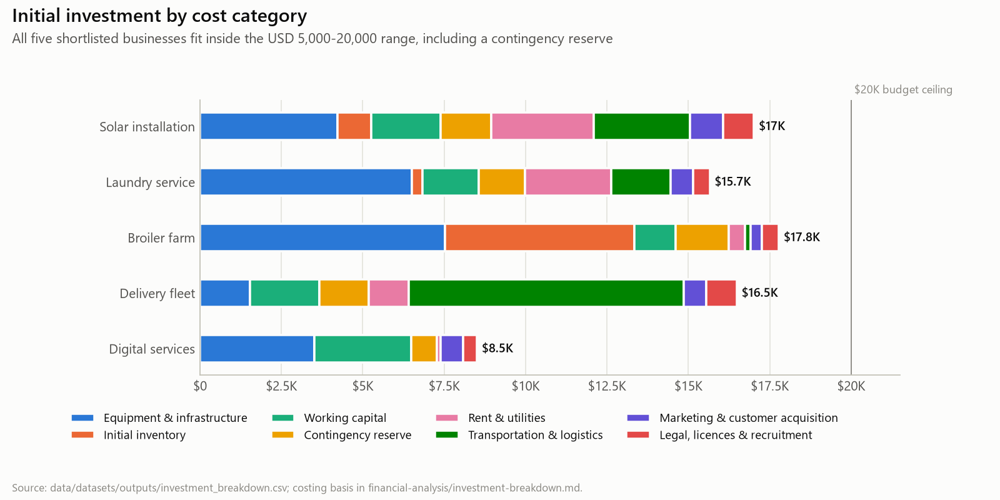
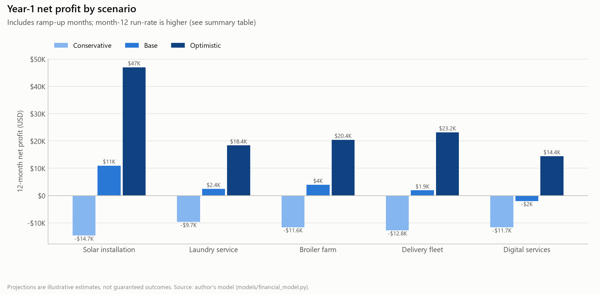
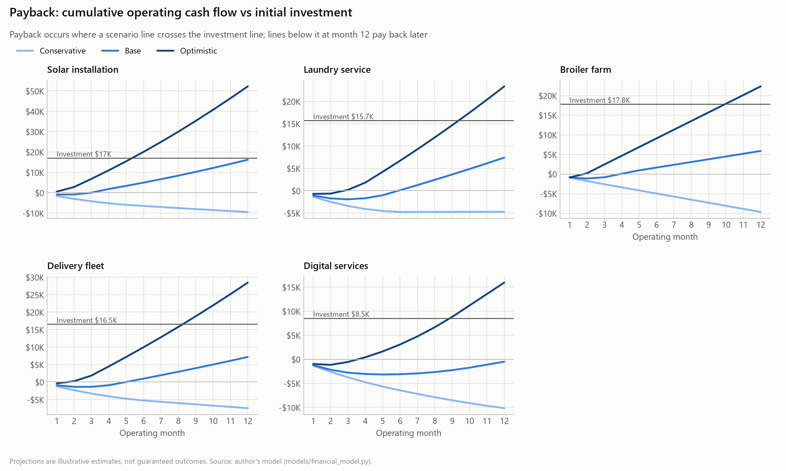
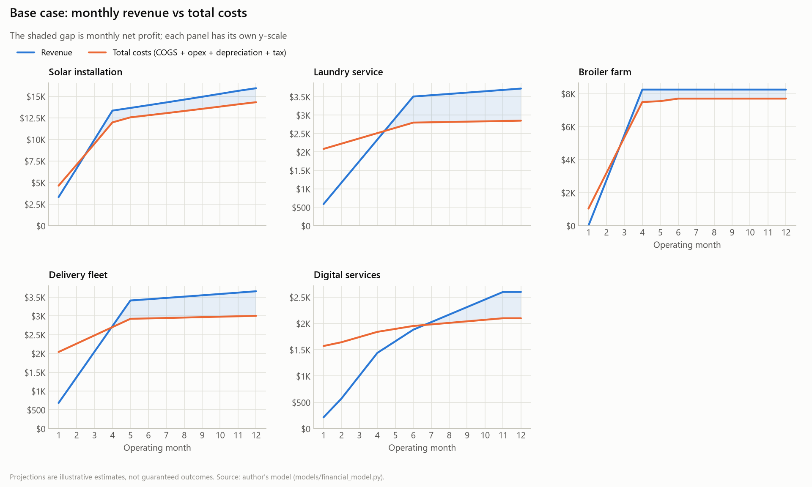
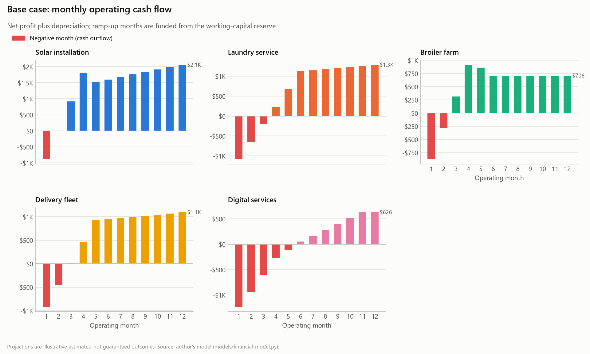
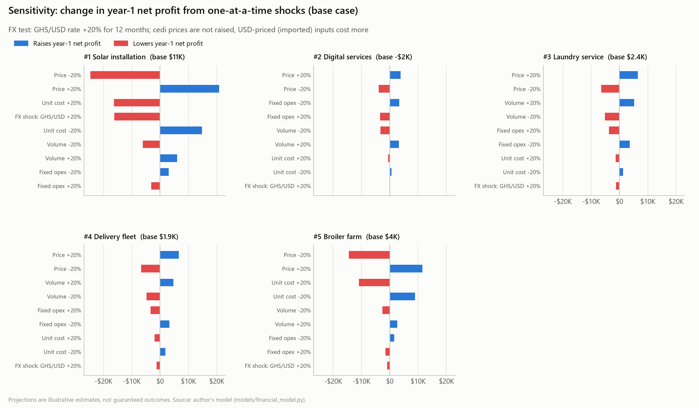
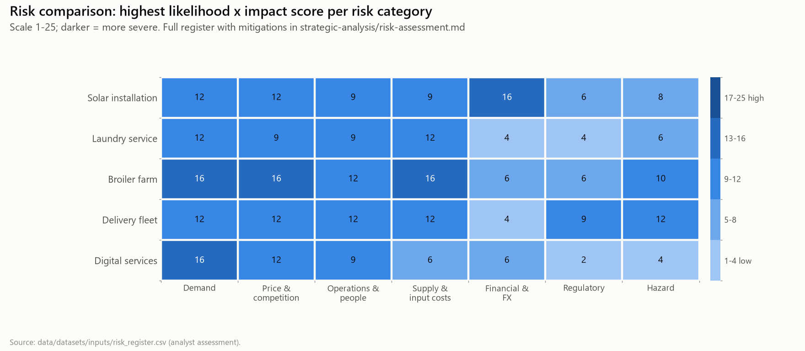
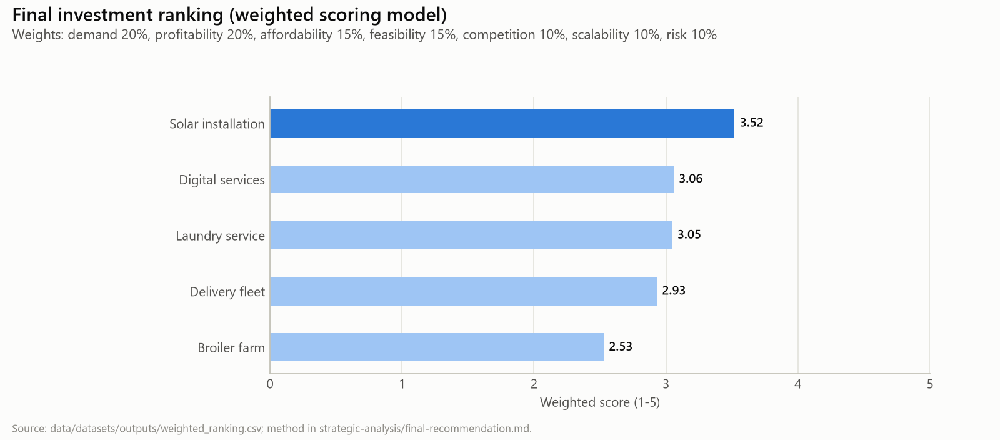
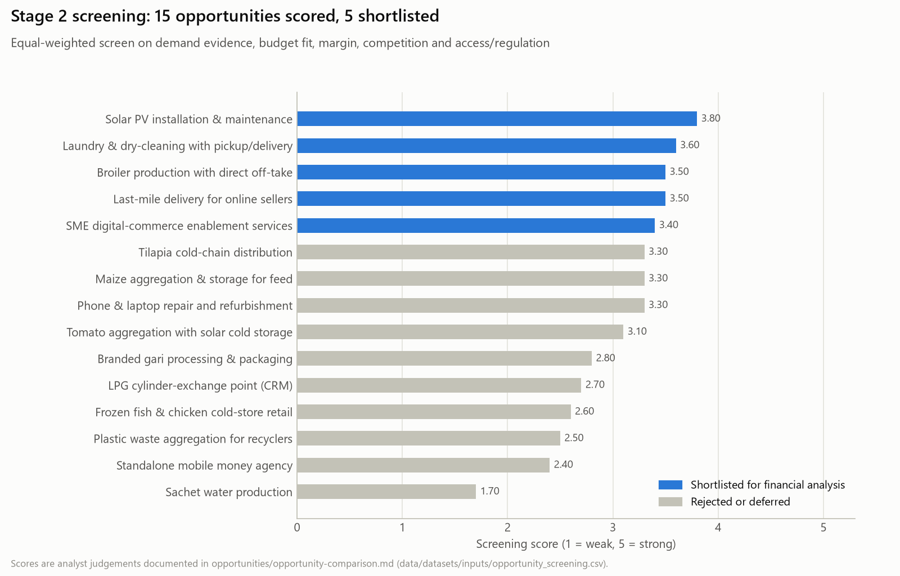

# Visual Investment Comparison

[← Back to README](../README.md)

> All charts are generated by [`models/make_charts.py`](../models/make_charts.py) from the CSV datasets in [`data/datasets/`](../data/datasets/). **No chart uses synthetic data.** Every series is a model input, a model output or an analyst score documented in a CSV. Colours follow a fixed, colour-blind-checked order (one colour per business); every multi-series chart has a legend, and every chart has a matching table elsewhere in the repository.

| # | Chart | What it shows | Underlying data |
|---|---|---|---|
| 1 | [Opportunity screening](financial-charts/01_opportunity_screening.png) | Stage 2 scores for all 15 opportunities | `inputs/opportunity_screening.csv` |
| 2 | [Investment allocation](financial-charts/02_investment_allocation.png) | Startup budget by category | `outputs/investment_breakdown.csv` |
| 3 | [Weighted ranking](financial-charts/03_weighted_ranking.png) | Final weighted scores | `outputs/weighted_ranking.csv` |
| 4 | [Revenue vs costs](financial-charts/04_revenue_vs_costs.png) | Monthly revenue against total costs (base case) | `outputs/monthly_projections.csv` |
| 5 | [Break-even and payback](financial-charts/05_break_even_payback.png) | Cumulative cash flow vs investment, three scenarios | `outputs/monthly_projections.csv` |
| 6 | [Monthly cash flow](financial-charts/06_monthly_cash_flow.png) | Operating cash flow by month (base case) | `outputs/monthly_projections.csv` |
| 7 | [Scenario net profit](financial-charts/07_scenario_net_profit.png) | Year-1 net profit, three scenarios | `outputs/summary_metrics.csv` |
| 8 | [Risk heatmap](financial-charts/08_risk_heatmap.png) | Highest risk score per category | `inputs/risk_register.csv` |
| 9 | [Sensitivity tornado](financial-charts/09_sensitivity_tornado.png) | ±20% shocks and FX stress test | `outputs/sensitivity_analysis.csv` |

---

## 1. Where the money goes



<!-- BEGIN TABLE: investment_by_category -->
| Category | Solar installation | Laundry service | Broiler farm | Delivery fleet | Digital services |
|---|---|---|---|---|---|
| Registration & legal | $509 | $253 | $306 | $593 | $168 |
| Equipment & infrastructure | $4,231 | $6,501 | $7,521 | $1,538 | $3,504 |
| Initial inventory | $1,026 | $342 | $5,812 | $0 | $0 |
| Rent & utilities | $3,162 | $2,650 | $513 | $1,231 | $128 |
| Transportation & logistics | $2,949 | $1,838 | $171 | $8,462 | $0 |
| Marketing & customer acquisition | $1,026 | $684 | $342 | $684 | $684 |
| Staffing (pre-opening) | $427 | $256 | $214 | $342 | $256 |
| Working capital | $2,137 | $1,709 | $1,282 | $2,137 | $2,991 |
| Contingency reserve | $1,547 | $1,423 | $1,616 | $1,499 | $773 |
| **Total initial investment** | **$17,013** | **$15,656** | **$17,777** | **$16,485** | **$8,505** |
<!-- END TABLE: investment_by_category -->

## 2. What the money earns — and can lose



<!-- BEGIN TABLE: scenario_net_profit -->
| Business | Conservative | Base | Optimistic | Spread (optimistic - conservative) |
|---|---|---|---|---|
| Solar installation | -$14,673 | $10,983 | $47,006 | $61,679 |
| Laundry service | -$9,674 | $2,440 | $18,382 | $28,057 |
| Broiler farm | -$11,602 | $3,955 | $20,422 | $32,024 |
| Delivery fleet | -$12,759 | $1,899 | $23,176 | $35,935 |
| Digital services | -$11,684 | -$2,012 | $14,422 | $26,105 |
<!-- END TABLE: scenario_net_profit -->

## 3. How fast it comes back



## 4. Monthly dynamics





## 5. What drives the result



## 6. Risk profile



## 7. Final ranking



## 8. How the shortlist was chosen



---

### Regenerating the charts

```bash
pip install -r requirements.txt
python models/run_all.py
```
